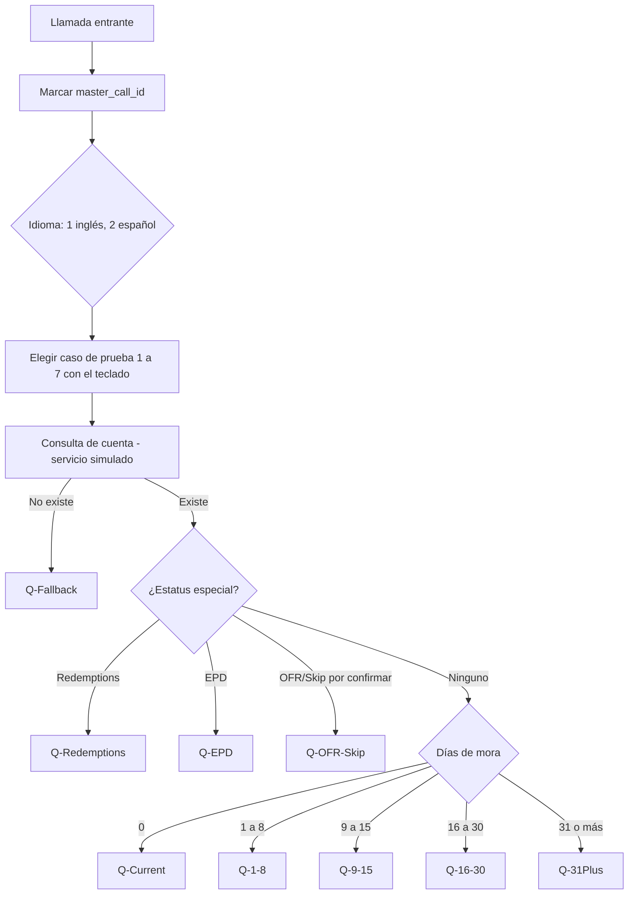
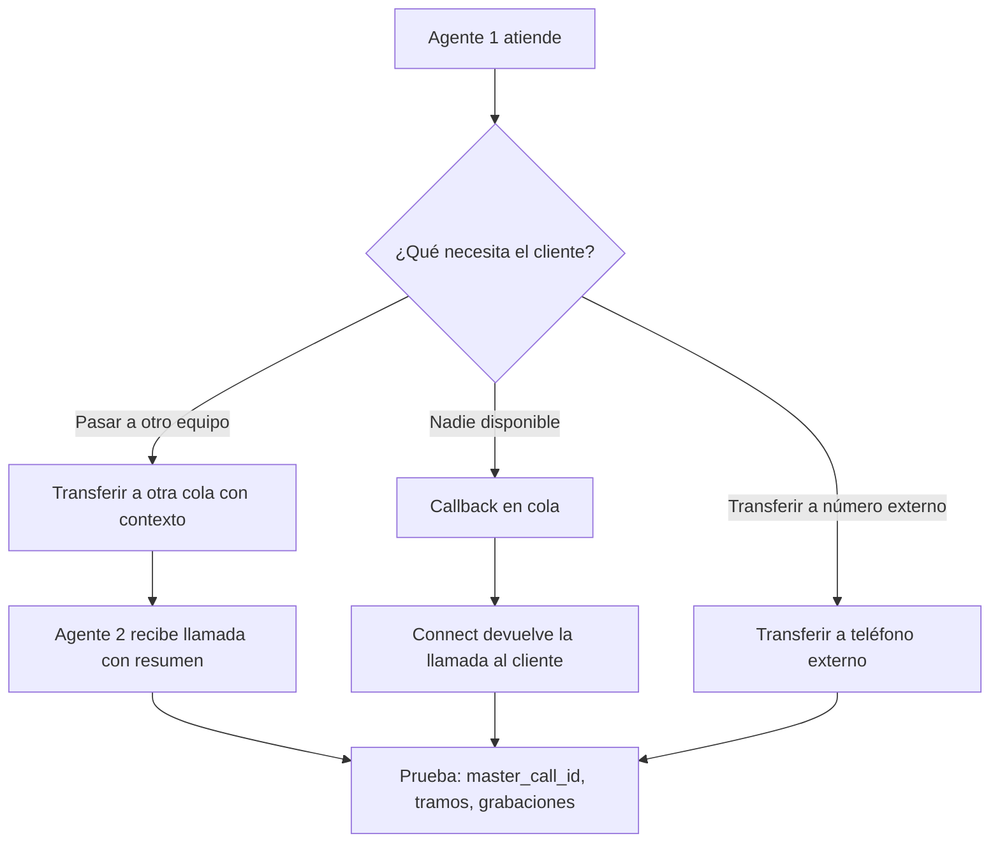
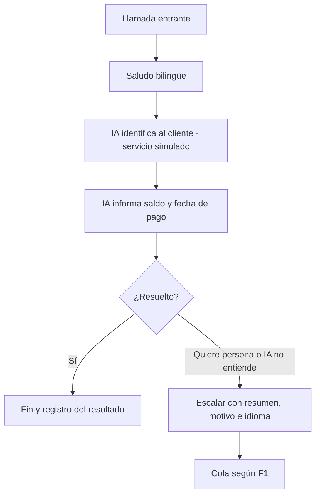
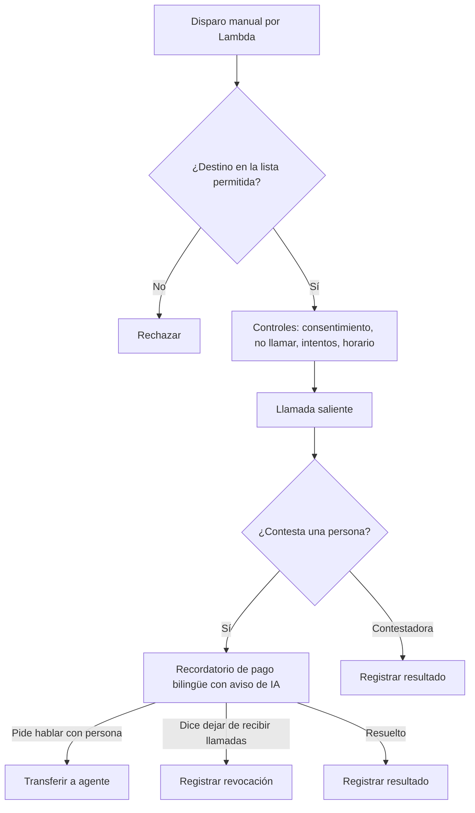

# Flujos de la PoC (versión exploratoria, actualizada 2026-11-09)

Cuatro flujos de contact center más dos escenarios híbridos, con datos inventados (ver `poc/data/personas.json`). Todo lo marcado **(por confirmar)** es una regla de negocio de MEI que se aclara en el descubrimiento. Idioma fijo: **es-US** (no es-MX) para bot, voz, analítica y evaluaciones.

## F1: Entrante, ruteo por idioma, estatus y mora

Regla clave: **el estatus especial se evalúa antes que la mora**. La consulta devuelve una sola respuesta con cola, prioridad e idioma, para que el flujo no tenga lógica de negocio.

## F2: Transferencia, callback y cadena de ID

Lo que ya dice la documentación (hay que **confirmarlo**, no asumirlo):

- Los atributos de usuario se comparten entre todos los contactos con el mismo `InitialContactId`, y **una transferencia puede sobrescribirlos**. `master_call_id` se escribe una sola vez; los datos de un tramo van en *segment attributes*.
- En el registro de contacto, `InitialContactId` es nulo en el primer tramo: el ID maestro es `InitialContactId` si existe, si no `ContactId`.
- "Transferir a número" desde un flujo **sigue grabando**. La transferencia externa hecha por el agente deja de grabar cuando el agente cuelga.
- Máximo 2 grabaciones por contacto.

## F3: Entrante con IA (consulta y escalada)

Variantes de la misma conversación, mismo guion y mismos casos:

| Variante | Oído | Cerebro | Voz | Estado |
|---|---|---|---|---|
| A | Nova Sonic | Nova Sonic | Nova Sonic (confirmar en consola si es Nova 2 y si aparece la voz "carlos") | Base |
| B | Agentic CX designer | Pasos fijos + IA | Voces de Connect | Opcional: mide si reemplaza el armado a mano |
| C | Deepgram | Connect | ElevenLabs (TTS dentro de Connect) | Requiere token de ElevenLabs (`us`) |
| D | Connect (STT) | Agente externo por A2A, modo texto | Connect o ElevenLabs | Solo si AWS y ElevenLabs lo habilitan; tope de 5 conexiones |

La IA solo informa y escala. **No captura tarjeta ni cierra pagos.** El aviso de que habla una IA y de que la llamada se graba va al inicio, en ambos idiomas.

## F4: Saliente, recordatorio a un teléfono propio

Solo a teléfonos del equipo, con lista de destinos permitidos. Nunca a clientes reales. Se agrega la **revocación de consentimiento** por voz o tecla, por la orden de la FCC vigente desde el 2026-11-25 (revisión legal pendiente). El SMS de pago queda fuera de esta ronda.

## H1: Híbrido, llamada que sigue en Zultys

Simula el modelo de dos sistemas, con un teléfono normal en el papel de Zultys. Dos pruebas:

1. **Transferencia a un número externo**, desde el flujo y desde el agente: qué se conserva (ID, contexto, grabación) y qué se pierde.
2. **Importación de grabaciones externas** (WAV estéreo de 8 kHz en S3 → contacto → análisis de Contact Lens): ¿se puede calificar con IA una llamada que nunca pasó por Connect? Si funciona, el QA de MEI no depende de migrar todo. SIPREC desde un SBC queda como pregunta para BrevAll.

## Reglas de negocio por confirmar

- Qué significa **OFR** y si hay más estatus especiales.
- Si Redemptions, OFR/Skip y EPD tienen colas y agentes distintos.
- Qué se le dice al cliente en cada tramo, y qué se puede informar tras verificar su identidad.
- Horarios de atención y de llamadas salientes.
