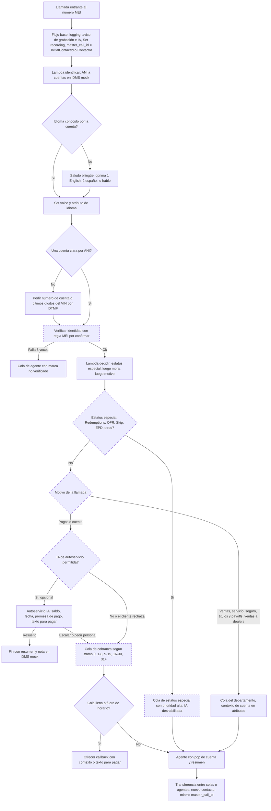
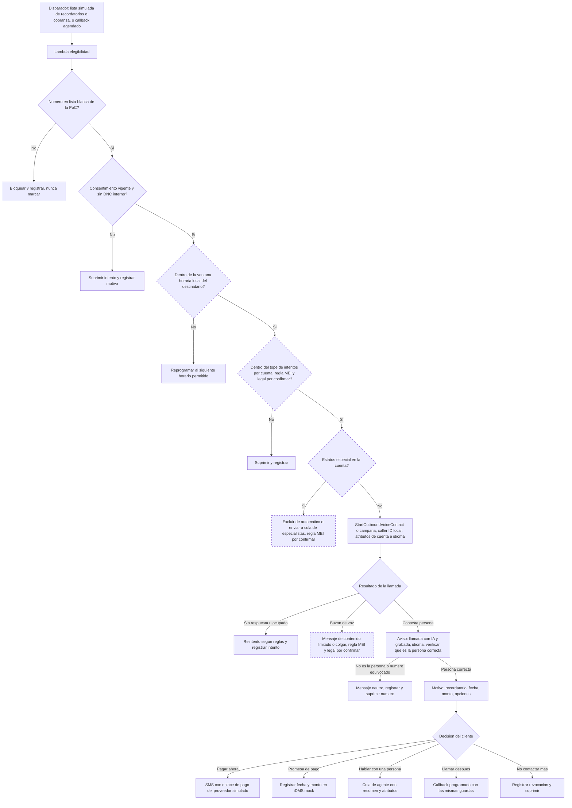
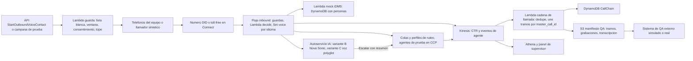

# Dos PoC convierten a Connect en el sistema de registro de MEI

> **Correcciones tras la verificación del 2026-11-09** (fuentes en [verificacion-supuestos-2026-11-09.md](verificacion-supuestos-2026-11-09.md)):
> - **ID único:** ya no es una duda abierta. Los atributos de usuario se comparten entre todos los contactos con el mismo `InitialContactId` y una transferencia puede sobrescribirlos; los datos de un solo tramo van en *segment attributes*. En el CTR, `InitialContactId` es `null` en el primer tramo.
> - **Grabación:** "Transfer to phone number" desde un flujo sigue grabando; solo se corta la transferencia externa hecha por el agente cuando este cuelga. Máximo 2 grabaciones por contacto; CTR 24 meses.
> - **Español:** usar **es-US**. es-MX no tiene voz agéntica ni analítica en la tabla oficial.
> - **Nova Sonic:** Nova 2 Sonic tiene es-US *lupe* y *carlos* y voces polyglot; la guía de Connect aún lista solo las 4 voces de lanzamiento. Confirmar en la consola cuál versión corre en us-east-1.
> - **A2A** es una función documentada de AWS (~2026-09-22): modo de audio (wss) y modo *text streaming* (Connect pone STT/TTS). Cuota: 5 conexiones concurrentes con agentes de terceros por instancia; configuración solo por API; no envía atributos personalizados; trazas obligatorias. Abre una variante "cerebro externo + voz de Connect o ElevenLabs como TTS".
> - **Agentic CX designer** (GA 2026-09-02): lienzo sin código con pasos deterministas y de IA; candidato a reemplazar el cerebro armado a mano en F3. Idiomas e IaC sin verificar.
> - **ElevenLabs en Connect** sigue en *limited availability*; Eleven Realtime disponible para todos desde 2026-11-02 (sin datos de español).
> - **TCPA:** orden de la FCC vigente desde 2026-11-25 sobre revocación de consentimiento; la propuesta de divulgación de IA sigue pendiente.

**Hoy (9 de noviembre de 2026) Amazon Connect puede cubrir de punta a punta lo que MEI necesita para una PoC: ruteo bilingüe por atributos, transferencias y callbacks con contactos encadenados, grabación estéreo en S3, supervisión con escucha e intervención, Contact Lens en español de EE. UU., una IA de voz nativa (Nova Sonic y "agentic voice") y llamadas y SMS salientes por API.** Lo que ninguna opción trae de fábrica es el "call ID único": en Connect cada transferencia crea un contacto nuevo con su propia grabación, así que el identificador maestro hay que sembrarlo y propagarlo, y esa es la propiedad que la PoC 1 debe demostrar. La recomendación es una PoC 1 de 3 a 4 semanas que simule inbound y outbound con datos simulados sobre Connect (flujo determinista para identidad, estatus, mora y cumplimiento, y la IA solo en el tramo de autoservicio), seguida de una PoC 2 corta que pruebe ElevenLabs primero como TTS dentro de Connect y después, si AWS y ElevenLabs la habilitan, como ElevenAgents por A2A, con los mismos escenarios para comparar peras con peras. De las alternativas, solo Deepgram (STT/TTS nativo en Connect) merece prueba práctica; PolyAI merece una demo de proveedor porque Zultys la soporta de forma explícita; el resto se descarta o queda como extra. Las mayores incógnitas son externas a la tecnología: qué significan OFR y los demás estatus, qué API expone iDMS/DealerSocket, qué clase de cobrador es MEI ante la ley, si la integración A2A de ElevenLabs sale de "disponibilidad limitada" a tiempo, y la calidad del español de EE. UU. de cualquier voz, que ninguna fuente independiente ha medido. Este informe también corrige dos afirmaciones previas de la conversación (cambio de idioma a mitad de llamada y fechas de Nova Sonic en español), detalladas en la sección 2.

## El mapa mental en cinco ideas

Si te sientes algo perdido, estas cinco ideas ordenan todo lo demás. Primera: en Connect el trabajo se reparte entre flujos (lógica de llamada), una Lambda que decide (reglas de MEI en código testeable) y el ruteo por colas y atributos. Segunda: la IA de voz es una pieza reemplazable dentro de ese flujo, no el sistema; por eso comparar Nova Sonic, voces polyglot de Connect, ElevenLabs y otras es barato si el esqueleto está bien hecho. Tercera: el cumplimiento y la identidad se resuelven con pasos deterministas, no con el LLM. Cuarta: el sistema de registro es la cadena de contactos de Connect más tu propia clave de correlación. Quinta: lo difícil de la PoC no es la tecnología sino los plazos de terceros (cupos, números, registro de SMS, habilitación de A2A) y las reglas de negocio de MEI que aún no conocemos, así que lo primero es abrir esos trámites el día 1.

Una nota de nombres que evita confusión: en 2026 AWS renombró el servicio de contact center como "Amazon Connect Customer"; las APIs, la CLI y CloudFormation siguen diciendo "Connect", y existe un nivel más barato "Customer Basic" sin las funciones de IA nuevas ([AWS pricing](https://aws.amazon.com/connect/pricing/), [Classmethod, tercero](https://dev.classmethod.jp/en/articles/amazon-connect-customer-pricing-name-change/)). Para esta PoC se asume el nivel "Customer", porque Nova Sonic, la configuración de STT/TTS de terceros y A2A no existen en Basic ([Pricing appendix](https://aws.amazon.com/products/connect/customer/pricing/appendix/)).

## Correcciones a lo dicho antes en la conversación

Hay dos afirmaciones previas que no resisten la revisión de las fuentes y conviene corregirlas explícitamente porque afectan el diseño bilingüe.

La primera es que el cambio de idioma a mitad de llamada "no está documentado" en Connect. Sí lo está. La guía de mejores prácticas de voz agéntica documenta voces multilingües (polyglot: Katie, Blake, Brooke, Ronald y Gemma, cada una con inglés, español, alemán, francés, hindi, italiano, japonés, noruego, portugués y ruso) y afirma que "un cliente puede empezar en inglés, cambiar a español y el agente lo sigue, sin cambios de flujo" ([Agentic voice best practices](https://docs.aws.amazon.com/connect/latest/adminguide/agentic-voice-best-practices.html)). El mecanismo es el prompt del agente de IA (detecta el idioma en la transcripción y responde en él) más una pista de ASR: el atributo de sesión `x-amz-lex:audio:locale-override` (por ejemplo `es,en-US`, hasta 10 pistas) sesga el reconocimiento hacia el segundo idioma sin restringirlo. Dos matices honestos: esa documentación aplica a la pila "agentic voice" con voces polyglot, no está dicho que aplique a la opción de voz a voz Nova Sonic con sus voces propias (Matthew, Amy, Olivia, Lupe), y nadie ha medido la calidad del acento en español de EE. UU. de esas voces. En paralelo, Nova 2 Sonic en Bedrock documenta voces polyglot (Tiffany, Matthew) y code-switching dentro de la misma frase ([Nova 2 language support](https://docs.aws.amazon.com/nova/latest/nova2-userguide/sonic-language-support.html)), pero no hay documento que confirme que Connect use Nova 2 Sonic y no la primera versión. Por tanto, la capacidad existe en papel y la PoC debe medirla, no asumirla ni descartarla.

La segunda es la cronología de Nova Sonic en español. Según lo indicado en el encargo, Nova Sonic ya hablaba español desde junio de 2025 como modelo de Bedrock (dato no verificado en las notas de esta investigación; confirmar en el feed What's New de AWS de ese mes). Lo de noviembre de 2025 es otra cosa: la integración con Connect, anunciada el 30 de noviembre de 2025 con disponibilidad general en inglés y español, y vista previa en francés, italiano y alemán, inicialmente en us-east-1 y us-west-2 ([What's New 2025/11](https://aws.amazon.com/about-aws/whats-new/2025/11/amazon-connect-agentic-self-service)). El informe anterior daba a entender que el español pleno llegó en noviembre de 2025; la distinción correcta es modelo (junio de 2025) frente a integración en Connect (noviembre de 2025). Desde entonces hubo más cambios: 40 locales de agentes de voz con IA en marzo de 2026, incluido español de México ([What's New 2026/03](https://aws.amazon.com/about-aws/whats-new/2026/03/amazon-connect-voice-ai-agents-13-languages)), y más de 50 idiomas, más de 100 voces y controles de velocidad, volumen y emoción en la voz agéntica en julio de 2026 ([What's New 2026/07](https://aws.amazon.com/about-aws/whats-new/2026/07/amazon-connect-agentic-voice/)).

Un tercer ajuste menor: el informe anterior trataba el "call ID" como si existiera en alguna opción. La documentación de Connect lo hace explícito: el identificador que atraviesa una cadena es `InitialContactId`, y en el primer tramo ese campo viene nulo en el registro del contacto, de modo que el ID maestro correcto es "`InitialContactId` si no es nulo, si no `ContactId`" ([Identify conferences and transfers](https://docs.aws.amazon.com/connect/latest/adminguide/identify-conferences-transfers.html)). La página de atributos del sistema, en cambio, lista `$.InitialContactId` como atributo disponible en el flujo ([Contact attribute list](https://docs.aws.amazon.com/connect/latest/adminguide/connect-attrib-list.html)); es una discrepancia entre fuentes que la PoC resuelve con una prueba directa.

## Qué hace Connect hoy: mapa de capacidades con su grado de certeza

Esta sección separa lo verificado en documentación de AWS, lo inferido y lo que sigue sin respuesta. La marca "V" significa verificado en página de AWS, "I" inferencia o diseño propuesto, "B" brecha. Los estados no sustituyen una prueba: son punto de partida.

| Capacidad | Qué ofrece hoy | Estado |
|---|---|---|
| Flujos y lógica | Bloques de Lambda (síncrono máx. 8 s, asíncrono 60 s, reintentos hasta 3 veces), Check/Set contact attributes, Data Table, Set voice, Set routing criteria; módulos reutilizables; el resultado de Lambda (`$.External.*`, máx. 32 KB) no se guarda en el registro del contacto salvo que se copie a un atributo propio ([Lambda block](https://docs.aws.amazon.com/connect/latest/adminguide/invoke-lambda-function-block.html), [Attribute list](https://docs.aws.amazon.com/connect/latest/adminguide/connect-attrib-list.html)) | V |
| Ruteo | Colas con prioridad y retraso por perfil de ruteo; atributos predefinidos con proficiencia 1 a 5 por agente; "Set routing criteria" con pasos, expiración y hasta 8 atributos en AND; criterios dinámicos que devuelve una Lambda en JSON ([Set routing criteria](https://docs.aws.amazon.com/connect/latest/adminguide/set-routing-criteria.html), [Predefined attributes](https://docs.aws.amazon.com/connect/latest/adminguide/predefined-attributes.html)) | V |
| "Estatus especial gana a la mora" | No es un patrón documentado; se implementa en una Lambda con orden explícito que devuelve cola, prioridad y proficiencia | I |
| Transferencias | Quick connects (usuario, cola, número externo); una transferencia crea un contacto nuevo vinculado por Previous/NextContactId; la transferencia a número externo no pasa por flujo y no se graba tras irse el agente ([Quick connects](https://docs.aws.amazon.com/connect/latest/adminguide/quick-connects.html), [Recording behavior](https://docs.aws.amazon.com/connect/latest/adminguide/about-recording-behavior.html)) | V |
| Callbacks | Callback en cola: contacto nuevo, hasta 7 días en cola, reintentos configurables; conserva su lugar en la fila si la cola tiene la misma prioridad; API CreateCallbackContact; no hay callback "programado" nativo en ese bloque (patrón de AWS con DynamoDB y Step Functions), pero las tareas pueden programarse hasta 90 días ([Queued callback](https://docs.aws.amazon.com/connect/latest/adminguide/setup-queued-callback.html), [Quotas](https://docs.aws.amazon.com/connect/latest/adminguide/amazon-connect-service-limits.html)) | V |
| Grabación | Máximo dos grabaciones por contacto (una de IVR/bot y otra de interacción con agente); estéreo (agente derecha, cliente izquierda; en la de IVR, cliente derecha y sistema izquierda); ubicación en `Recordings[].Location` del CTR, disponible tras el cierre del ACW ([Recording behavior](https://docs.aws.amazon.com/connect/latest/adminguide/about-recording-behavior.html), [CTR model](https://docs.aws.amazon.com/connect/latest/adminguide/ctr-data-model.html)) | V |
| Exportación para QA externo | Streaming de CTR a Kinesis o Firehose y de eventos de agente a Kinesis, entrega "al menos una vez" (puede haber duplicados), CTR disponible 24 meses ([Data streaming](https://docs.aws.amazon.com/connect/latest/adminguide/data-streaming.html)); tablas de data lake con `initial_contact_id` ([Data lake](https://docs.aws.amazon.com/connect/latest/adminguide/data-lake-contact-data.md)) | V |
| Supervisor | Monitoreo mejorado: hasta 2 supervisores por llamada (dos en silencio, o uno en silencio y uno interviniendo), solo desde CCPv2/Agent Workspace ([Monitor conversations](https://docs.aws.amazon.com/connect/latest/adminguide/monitor-conversations.html)); métricas en tiempo real e históricas (GetMetricDataV2) | V |
| Experiencia del agente | Navegador (CCP v2 o Agent Workspace) sobre WebRTC, sin puertos de entrada; requiere lista de dominios y UDP 3478 a TURN ([CCP networking](https://docs.aws.amazon.com/connect/latest/adminguide/ccp-networking.html)) | V |
| Telefonía y Zultys | Reclamar números DID o toll-free; portar números con el mismo formulario de cuotas; 911 solo por llamada directa del agente; no hay troncal SIP BYOC documentada para Connect; "external voice transfer" (diciembre de 2024) entrega llamadas y metadatos a otro sistema de voz sin pasar por la PSTN y se presenta como ayuda de migración, a $0.032/min más $100 por conector al día ([Claim a number](https://docs.aws.amazon.com/connect/latest/adminguide/claim-phone-number.html), [External voice](https://docs.aws.amazon.com/connect/latest/adminguide/external-voice-transfer.html), [Pricing appendix](https://aws.amazon.com/products/connect/customer/pricing/appendix/)) | V (parcial) |
| Coexistencia con Zultys | Plan inferido: mantener el número en el operador actual, reenviar a un DID de Connect, validar y luego portar; el puente por Chime SDK Voice Connector proviene de una respuesta de comunidad ([re:Post](https://repost.aws/questions/QUz8xMKtgBTpOy5IIu_4XlLQ/question-about-connecting-a-dedicated-sip-trunk-to-amazon-connect)) | I |
| IA de voz | Nova Sonic voz a voz sobre un bot Lex con `AMAZON.QInConnectIntent`; "agentic voice" (ASR más TTS, 50+ idiomas) como proveedor por defecto; herramientas MCP; escalación con contexto mediante herramienta de retorno de control personalizada; STT/TTS de terceros (Deepgram, ElevenLabs) y agentes externos por A2A ([Agentic self-service](https://docs.aws.amazon.com/connect/latest/adminguide/agentic-self-service.html), [Nova Sonic S2S](https://docs.aws.amazon.com/connect/latest/adminguide/nova-sonic-speech-to-speech.html), [A2A setup](https://docs.aws.amazon.com/connect/latest/adminguide/a2a-setup-external.html)) | V |
| Bilingüe | `Set voice` dinámico, atributo de idioma, voces polyglot y `locale-override` (ver correcciones); es-US figura como compatible en agentes de IA, voz agéntica, evaluaciones, análisis, resúmenes y redacción ([Supported languages](https://docs.aws.amazon.com/connect/latest/adminguide/supported-languages.html)) | V; calidad B |
| Contact Lens | Análisis en tiempo real y posterior a la llamada, sentimiento, resúmenes y evaluaciones automáticas, todo en es-US; la redacción de PII es posterior a la llamada y no impide que el LLM vea el dato crudo; evaluaciones de interacciones de IA incluidas en "Customer" ([Supported languages](https://docs.aws.amazon.com/connect/latest/adminguide/supported-languages.html), [Pricing appendix](https://aws.amazon.com/products/connect/customer/pricing/appendix/)). Voice ID dejó de existir el 20 de mayo de 2026 | V |
| Saliente | Campañas (agente asistido: predictivo, progresivo, vista previa; voz automatizada; SMS; correo; WhatsApp) con ventanas por zona horaria del destinatario, topes de comunicaciones, reintentos, AMD ([Guided builder](https://docs.aws.amazon.com/connect/latest/adminguide/guided-campaign-builder.html), [Best practices](https://docs.aws.amazon.com/connect/latest/adminguide/outbound-campaign-best-practices.html)); API `StartOutboundVoiceContact` con atributos de hasta 32 KB ([API](https://docs.aws.amazon.com/connect/latest/APIReference/API_StartOutboundVoiceContact.html)) | V |
| SMS | Números de AWS End User Messaging importados a Connect; 10DLC requiere marca y campaña; toll-free requiere formulario; en sandbox solo a números verificados; STOP/HELP los gestiona la plataforma salvo que actives la gestión propia ([Set up SMS](https://docs.aws.amazon.com/connect/latest/adminguide/setup-sms-messaging.html)); no existe "link de pago" nativo | V |
| Pruebas | Testing and simulation nativo (diseñador visual y APIs; simula DTMF y frases, mockea Lambda, horarios, colas y Lex; 5 pruebas concurrentes, 5 minutos máx. por prueba) ([Execute test cases](https://docs.aws.amazon.com/connect/latest/adminguide/testing-simulation-execute-test-cases.html), [What's New 2026/02](https://aws.amazon.com/about-aws/whats-new/2026/02/amazon-connect-provides-apis-test-simulate-voice-interactions/)) | V |
| IaC | CloudFormation (`AWS::Connect::ContactFlow` con el JSON del flujo, hasta 256,000 caracteres), CDK y Terraform; la asociación número-flujo requiere recurso personalizado ([CFN](https://docs.aws.amazon.com/AWSCloudFormation/latest/TemplateReference/aws-resource-connect-contactflow.html)) | V |

Hay tres vacíos que se cierran solo con prueba: si los atributos definidos por el usuario se copian al contacto creado por una transferencia (las notas traen una fuente que dice que los atributos se comparten entre contactos con el mismo `InitialContactId` y otra que lo declara no verificado), el comportamiento exacto de un callback programado creado como tarea, y si Contact Lens evalúa contactos atendidos solo por IA en es-US en tu instancia. Tampoco está documentado el nombre exacto de la clave S3 de las grabaciones: la documentación dice que suele empezar con el ID del contacto pero "sin garantía", por eso se usa siempre el campo `Location` del CTR.

## Qué ofrece ElevenLabs dentro y fuera de Connect

La conversación anterior ya cubrió la plataforma; aquí solo lo necesario para la PoC 2 ([informe previo, sección de capacidades](ElevenLabs%20capacidades%20contact%20center.md)).

**Dentro de Connect hay dos caminos con pesos muy distintos.** El camino ligero es ElevenLabs como proveedor de TTS en el bloque `Set voice`: se guarda tu API key de ElevenLabs en Secrets Manager (misma región, cifrada con una clave KMS de cliente y con política de recurso que permita a Connect leerla) y se escriben a mano modelo, voz e idioma; Connect envía el texto y reproduce el audio, y Connect sigue siendo el cerebro (Lex o el agente de IA de Connect) ([Configure third-party TTS](https://docs.aws.amazon.com/connect/latest/adminguide/configure-third-party-tts.html)). Eso se anunció en noviembre de 2025 junto a Deepgram como STT ([What's New 2025/11](https://aws.amazon.com/about-aws/whats-new/2025/11/amazon-connect-third-party-speech-to-text-to-speech-ai-models)). No hay documentación de qué modelos y voces de ElevenLabs acepta el campo, ni de latencia, ni de si funciona con español de EE. UU.; y como la opción de voz a voz de Nova Sonic ya trae su propia voz, es razonable inferir que el TTS de terceros aplica a la pila en cascada (STT más LLM más TTS) y no a Nova Sonic, algo que debe confirmarse en consola. El camino pesado es ElevenAgents por A2A: ElevenLabs asume la conversación completa por WebSocket, con audio PCM de 16 bits, y Connect solo recibe el desenlace `Complete` o `Escalate`. Requiere que AWS habilite el soporte de agentes de terceros en la cuenta y que ElevenLabs habilite el transporte de Amazon Connect en el workspace; la propia documentación lo marca como "disponibilidad limitada" y pide contactar al representante antes de producción ([ElevenLabs Amazon Connect](https://elevenlabs.io/docs/eleven-agents/phone-numbers/c-caa-s-integrations/amazon-connect)).

Las limitaciones de ese camino importan para MEI: no hay herramientas de cliente ni de tonos de teclado, el agente no puede marcar números ni URIs SIP (la transferencia ocurre solo mediante una regla de Connect), los resultados de recolección de datos no vuelven al flujo, los atributos de contacto personalizados no viajan (solo número llamante, número llamado, ID de contacto, canal e IDs de instancia como variables dinámicas), y el flujo no sabe el motivo de la escalada; la solución documentada es una herramienta webhook que escribe el resumen con `UpdateContactAttributes` mediante una Lambda y un flujo de susurro que lo reproduce, llamándola un turno antes de la transferencia para evitar una carrera. La configuración es en buena parte por API (AppIntegrations `A2A_SERVER`, perfil de seguridad, agente orquestador con un solo traspaso inmediato) y en el lado de Connect el bot Lex debe usar voz a voz con una sola intención `AMAZON.QInConnectIntent` ([A2A quotas](https://docs.aws.amazon.com/connect/latest/adminguide/a2a-quotas.html)). El precio en el apéndice de AWS es $0.01/min por voz bidireccional con un agente de terceros, y AWS pide validar latencia y calidad de audio con tu equipo de cuenta antes de producción ([Pricing appendix](https://aws.amazon.com/products/connect/customer/pricing/appendix/)).

**Fuera de Connect**, ElevenAgents entra por Twilio nativo o SIP trunking (TLS 1.2+, códecs G.722/PCMU/PCMA, headers `X-` convertidos en variables `sip_*`), con campañas salientes (ventanas por zona horaria, reintentos, callbacks, DNC por campaña) y la herramienta de idioma `language_detection` ([SIP trunking](https://elevenlabs.io/docs/eleven-agents/phone-numbers/sip-trunking.md), [Campaigns](https://elevenlabs.io/docs/eleven-agents/phone-numbers/campaigns.md)). Para MEI esa ruta es la menos atractiva porque parte la llamada en dos registros (el de la telefonía y el de ElevenLabs) y hay que unirlos con un identificador propio; por eso no entra en la PoC salvo como nota. Eleven Realtime (voz a voz, anunciado el 20 de octubre de 2026) reportó 0.57 a 0.62 s hasta el primer audio según el proveedor, y sitios secundarios citan 470 y 570 ms: las cifras se contradicen y son de fabricante, no de Connect ([ElevenLabs changelog](https://elevenlabs.io/docs/changelog), [The New Stack](https://thenewstack.io/elevenlabs-voice-agent-tradeoffs/)).

**Conflictos de fuentes que hay que tener presentes.** El blog de ElevenLabs del 4 de noviembre de 2026 describe la integración con Connect como nativa y dice que el agente de IA de Connect puede traer a un agente de ElevenAgents "a mitad del contacto" y que el control vuelve después; la documentación técnica del mismo integrador habla de traspaso inmediato único, disponibilidad limitada y solo `Complete` o `Escalate` ([blog](https://elevenlabs.io/blog/elevenagents-contact-center-integrations)). Sobre el cambio de idioma, la propia ElevenLabs se contradice: la página de idiomas dice que la selección es fija durante la llamada y la de `language_detection` describe cambio dinámico. Y un revendedor (ProUCX, $300 por agente activo al mes en AWS Marketplace) afirma que la ruta SIP rompe Contact Lens y parte el registro, lo cual es marketing de un tercero sin verificar ([Marketplace](https://aws.amazon.com/marketplace/pp/prodview-ohuadw23jly2y)).

## Alternativas: a quién probar, a quién llamar y a quién descartar

Ninguna fuente mide la calidad del español de EE. UU. de ningún proveedor, y casi todas las cifras de latencia y precio vienen de resúmenes secundarios de Artificial Analysis o de blogs de competidores, así que la tabla resume el estado del arte para decidir qué probar, no para elegir ganador. En el arena independiente de septiembre de 2026 (resumido por un sitio secundario), ElevenLabs Agents quedó en 993 de Elo de preferencia con 90.5% de cumplimiento de tareas, Nova 2 Sonic en 974 con 57.1%, Deepgram Voice Agent en 914 con 73.7% y Gemini 3.8 Live en 1083 con 93.2%; son pruebas en inglés ([Digital Applied](https://www.digitalapplied.com/blog/realtime-voice-models-benchmarks-vs-listener-preference)).

| Alternativa | Camino a Connect | Evidencia en español | Precio público (tercero/no verificado) | Recomendación |
|---|---|---|---|---|
| Deepgram (STT Nova-3, TTS Aura-2; Voice Agent) | STT/TTS nativos en Connect, guía de Voice Agent vía pasarela propia, listado en Marketplace ([guía](https://developers.deepgram.com/guides/integrations/amazon-connect-and-deepgram-voice-agent), [config STT](https://docs.aws.amazon.com/connect/latest/adminguide/configure-third-party-stt.html)) | Listado de Nova-3 en español; cobertura en Connect no confirmada | Crédito de $200 al registrarse (vencimiento incierto); Voice Agent ~$0.075 a $0.163/min | **Incluir (práctico), como componente dentro de Connect, no como Voice Agent completo** |
| PolyAI | Integración con Connect y traspaso a agentes; Zultys la soporta de forma explícita ([PolyAI](https://poly.ai/integrations/amazon-connect/), [Zultys 19](https://www.zultys.com/release/zultys-mx-release-19-0-zac-10-0-10-ai-powered-productivity-tools/)) | Caso de PG&E en inglés y español; sin caso de cobranza | Sin lista; estimaciones de seis cifras anuales | **Incluir como demo de proveedor, no como PoC práctica** (útil si Zultys convive mucho tiempo) |
| OpenAI gpt-realtime | SIP nativo, sin guía de Connect; requeriría Chime Voice Connector y no hay headers personalizados | No encontrada | ~$0.30/min base | Extra opcional en la semana 6 si sobra tiempo; no entra en el núcleo |
| Gemini 3.x Live | Sin camino documentado a Connect | No verificada | La más barata normalizada ($0.84/h en 3.8 Live) | Extra opcional como referencia de modelo |
| Cartesia, Parloa | Cartesia: Marketplace sin conector; Parloa: SIP desde Connect | Afirmaciones del proveedor | Sin precio público claro | Descartar de la PoC (Cartesia solo si falla la voz de ElevenLabs) |
| Skit.ai | No figura en sus integraciones; SIP/PSTN | Pensado para FDCPA/Reg F; inglés y español según tercero | Basado en ventas | No hacer PoC; sí una conversación comercial para pedir por escrito PCI, Reg F y español |
| Retell, Vapi, Bland, Synthflow | Retell y Synthflow tienen guía con Connect; el resto, SIP genérico | Sin evidencia | $0.05 a $0.31/min anunciados | Descartar (orquestadores que añaden otra capa) |
| Speechmatics, Soniox | Solo STT, camino propio | Cifras del proveedor; Soniox reclama cambio inglés-español | Sin precio verificado | Descartar como producto; usar solo como comparación de STT si Deepgram falla |
| Hume EVI | Telefonía vía Twilio | Español en EVI 4-mini | Un agregador dice que cierra el 13 de noviembre de 2026 (sin confirmar) | Descartar |

El criterio de fondo es que, como Connect ya acepta Deepgram y ElevenLabs como piezas intercambiables, la prueba más barata y con mayor información es mover una pieza a la vez dentro del mismo esqueleto, y no sumar integraciones por SIP que parten el registro de la llamada y obligan a pasar el contexto por otro medio (las notas indican que Connect no adjunta headers SIP personalizados en transferencias, así que el contexto tendría que reconstruirse por búsqueda del número llamante).

## Borrador de flujos: qué se migraría o sustituiría

Los flujos de abajo son un punto de partida que ordena la conversación de descubrimiento, no una especificación. Todo lo marcado como "regla de MEI por confirmar" (en el diagrama, nodos con borde punteado) es una suposición mía sobre un negocio que no conozco. En particular, **no sé qué significa OFR**; propongo que descubrimiento lo defina antes de implementarlo, y trato Redemptions, Skip y EPD con significados plausibles del sector (derecho de recuperar un vehículo repose­ído, cliente ilocalizable, incumplimiento temprano de pago) que MEI debe confirmar, igual que si hay otros estatus (quiebra, fallecido, disputa, abogado, cease-and-desist) que sí o sí deberían ir antes.

### Flujo entrante

La idea es que la Lambda "decide" sea una función pura y testeable que recibe el resultado de iDMS y devuelve un mapa plano de strings (cola, prioridad, idioma, proficiencia requerida, si la IA está permitida, texto de aviso), y que el flujo solo ejecute lo que esa función dicta. La precedencia es: primero estatus especial, después tramo de mora (0, 1-8, 9-15, 16-30, 31+ días), después motivo de la llamada. Poner la precedencia en código y no en ramas del flujo evita agotar los 100 flujos por instancia y permite probarla con pruebas unitarias.

La explicación de los pasos clave es la siguiente. El aviso de grabación y de IA va antes de cualquier captura porque la grabación empieza en el bloque `Set recording and analytics behavior`, no al inicio de la llamada, y porque las leyes de consentimiento a la grabación varían por estado (sección de cumplimiento). Mientras no se activa el bloque no hay audio del tramo previo. La identificación por número llamante es una pista, no una prueba: el cliente puede llamar desde otro teléfono, de modo que la verificación (qué datos pide MEI para hablar de una cuenta de crédito) es una regla de MEI. La decisión de estatus especial va antes de la mora, como pidió MEI, y propongo que el estatus especial deshabilite la IA de autoservicio hasta que MEI diga lo contrario, porque son casos en los que un error de la IA es más caro. El orden entre "motivo" y "mora" cuando el cliente en 31+ llama por seguro o títulos también es una regla de MEI por confirmar: el diagrama asume que el motivo manda cuando no es de pagos, pero MEI podría querer que un cliente en mora avanzada pase por cobranza siempre.

Un detalle bilingüe: para la ruta de IA conviene probar dos modos, el de idioma fijado al inicio (menú o preferencia de la cuenta) y el de voz polyglot con `locale-override`, que sigue al cliente si cambia de idioma; el primero es más predecible y el segundo más natural, y la PoC debe medir cuál se equivoca menos. Para el ruteo humano bilingüe, el idioma se modela como atributo predefinido con proficiencia por agente (por ejemplo `lang:es` nivel 1 a 5) y "Set routing criteria" en pasos con expiración, de modo que se prefiera un agente bilingüe de nivel alto y después se relaje la exigencia si la espera crece ([Predefined attributes](https://docs.aws.amazon.com/connect/latest/adminguide/predefined-attributes.html)).

### Flujo saliente

El saliente es un problema de guardas antes de ser un problema de voz. Cada intento pasa primero por una Lambda de elegibilidad que decide si se puede llamar (consentimiento, DNC interno, ventana horaria del destinatario, tope de contactos de la cuenta y estatus especial) y solo entonces dispara la llamada. En la PoC se añade además una lista blanca dura de números de prueba.

Hay dos restricciones técnicas que moldean la PoC. La detección de buzón (AMD) solo existe con tráfico de tipo CAMPAIGN, y las llamadas de campaña vienen bloqueadas por defecto: el cupo "Concurrent campaign active calls" parte en **0** hasta que se solicita un aumento ([API](https://docs.aws.amazon.com/connect/latest/APIReference/API_StartOutboundVoiceContact.html), [Quotas](https://docs.aws.amazon.com/connect/latest/adminguide/amazon-connect-service-limits.html)). Por eso la ruta de buzón no se puede probar el primer día; se cubre con la prueba nativa simulada hasta que llegue el cupo. AWS además advierte que la detección de máquina puede no cumplir las leyes de telemarketing y que el cliente es responsable ([Best practices](https://docs.aws.amazon.com/connect/latest/adminguide/outbound-campaign-best-practices.html)). La segunda restricción es que los controles de campaña (ventana horaria por zona del destinatario, topes de comunicación que cuentan hasta los buzones, reintentos) son genéricos: nada en la documentación implementa el límite de siete intentos en siete días por deuda ni la gestión de consentimientos, así que el libro de intentos y el almacén de consentimientos son componentes propios, aunque simulados en la PoC.

## PoC 1: simular el flujo completo en Connect, con datos de mentira y números del equipo

### Alcance y arquitectura

El objetivo es demostrar, con evidencia reproducible, que Connect puede ser el sistema de registro de MEI: que un identificador maestro sobrevive a transferencias, callbacks y cambios de agente; que cada tramo tiene grabación localizable; que los datos salen hacia un sistema de QA externo; y que la IA de autoservicio atiende los mismos escenarios que el flujo determinista en inglés y en español. Queda fuera: datos reales de clientes, captura real de tarjetas, números portados, y cualquier llamada a personas ajenas al equipo.

Los componentes se despliegan con CDK o Terraform; el flujo se diseña primero en la consola, se exporta el JSON y se parametriza por ARN, porque los flujos escritos a mano son frágiles por los UUID y las transiciones anidadas ([AWS blog](https://aws.amazon.com/blogs/contact-center/managing-amazon-connect-flows-as-code-with-aws-cdk)). Para la analítica sirve de base el repositorio `aws-samples/amazon-connect-data-analytics-sample` (pila CDK de CTR a Kinesis, Firehose, S3, Glue y Athena; sus requisitos de Node están viejos y hay que revisarlos) ([repo](https://github.com/aws-samples/amazon-connect-data-analytics-sample)). Los ejemplos de Nova Sonic con Connect existen pero son mayormente de AWS Samples con Bedrock directo; no hay un repositorio oficial de PoC integral.

La IA se monta con variantes conmutables por configuración, para que la misma batería de escenarios corra contra cada una: **A**, flujo determinista con Lex clásico y Polly neural en es-US/en-US (la línea base barata y predecible); **B**, agente de IA con Nova Sonic voz a voz (voces Matthew en-US y Lupe es-US), con el idioma fijado al inicio por la preferencia de la cuenta o el menú; **C**, voz agéntica con una voz polyglot y `locale-override="es,en-US"`, para medir el seguimiento de cambio de idioma. En B y C las verificaciones, avisos legales y captura de datos sensibles siguen siendo bloques deterministas (el "Agentic CX designer", disponible desde septiembre de 2026, apunta justo a mezclar pasos deterministas con IA, aunque no se evaluó en las notas), y la IA solo recibe una herramienta de consulta de saldo y fecha, una de promesa de pago, una de texto para pagar y las dos de retorno de control `Complete` y `Escalate` con un esquema propio (intención, sentimiento, motivo y resumen de hasta 500 caracteres) ([Agentic self-service](https://docs.aws.amazon.com/connect/latest/adminguide/agentic-self-service.html)).

### Servicio mock de cuentas y personas

El mock imita lo que se supone que ofrecerá iDMS/DealerSocket, de lo cual no sabemos nada (si es API REST, base de datos, archivo o integración propietaria, con qué latencia). Por eso se diseña con una frontera estrecha y reemplazable: una Lambda con una tabla DynamoDB `Accounts` (clave por teléfono E.164 y por número de cuenta), invocada directamente desde el flujo, sin API Gateway, aunque se puede añadir una URL de función para probarla con Postman. La Lambda responde un mapa plano de strings en menos de 8 segundos (el límite síncrono del bloque), con cold start amortiguado por concurrencia aprovisionada o un precalentamiento, y el mismo contrato lo usa el agente de IA como herramienta. Las operaciones son: búsqueda por teléfono, búsqueda por cuenta, `decide` (la precedencia completa), registro de promesa de pago, solicitud de texto para pagar, solicitud de callback, nota de contacto, y una consulta de elegibilidad saliente (consentimiento, ventana, tope y estatus).

Para que un solo teléfono represente a cualquier cliente, hay una tabla `TestSession` y una pequeña herramienta de línea de comandos o página que asigna una persona al número del probador antes de llamar ("hoy mi celular es Persona 7"). Así 4 o 5 teléfonos del equipo cubren todo el catálogo, y en saliente cada persona tiene un destino de prueba que apunta a un teléfono del equipo.

| # | Persona | Mora | Estatus | Idioma | Qué ejercita |
|---|---|---|---|---|---|
| 1 | Al corriente | 0 | ninguno | en | Camino feliz, pago adelantado, IA completa |
| 2 | Recién vencida | 1-8 | ninguno | en | Recordatorio, promesa de pago, texto para pagar |
| 3 | Vencida media | 9-15 | ninguno | es | Autoservicio en español, escalada con resumen |
| 4 | Vencida avanzada | 16-30 | ninguno | en | Cola de cobranza, callback con contexto |
| 5 | Mora crítica | 31+ | ninguno | es | Cola de cobranza avanzada, IA opcional |
| 6 | Redemptions | 31+ | Redemptions | en | Estatus gana a mora, IA deshabilitada |
| 7 | OFR | 16-30 | OFR (definición por confirmar) | es | Precedencia y marcador de regla pendiente |
| 8 | Skip | 31+ | Skip | en | Salida bloqueada en saliente, entrante a especialistas |
| 9 | EPD | 0-8 | EPD | es | Estatus gana a una mora baja |
| 10 | Bilingüe que cambia | 9-15 | ninguno | en que pasa a es | Cambio de idioma a mitad de llamada |
| 11 | Spanglish | 1-8 | ninguno | es y en mezclados | Comprensión con code-switching |
| 12 | Motivo no-cobranza | 16-30 | ninguno | en | Ventas, servicio, seguro, títulos y payoffs, ventas a dealers |
| 13 | Sin consentimiento | 1-8 | ninguno | es | Saliente suprimido, solo entrante |
| 14 | Número equivocado | n/a | n/a | en | Tercero que contesta, mensaje neutro y supresión |
| 15 | Varias cuentas por ANI | 9-15 y 0 | ninguno | en | Desambiguación de cuenta |
| 16 | Sin coincidencia | n/a | n/a | es | Identificación fallida a agente no verificado |

Los datos son inventados (nombres, VIN, saldos); ninguna persona del mock corresponde a un cliente real, ni siquiera por derivación, y se documenta así.

### Escenarios de prueba

Cada escenario se define una sola vez (persona, entrada hablada y DTMF, resultado esperado de ruteo, atributos y registro) y se ejecuta en tres capas: pruebas nativas de Connect con la Lambda mockeada (para lógica, rápidas y repetibles en CI mediante las APIs), llamadas reales con voz para audio y latencia, y pruebas unitarias de la Lambda `decide` (para la precedencia).

| Grupo | Escenarios |
|---|---|
| Entrante determinista | Camino feliz por cada tramo de mora (0, 1-8, 9-15, 16-30, 31+); estatus especial gana a mora para cada estatus; motivo no-cobranza por cada departamento; sin coincidencia o ANI ambiguo; horario cerrado; cola llena con oferta de callback |
| Idioma | Inicio en inglés y en español; menú de idioma; cambio de idioma a mitad de llamada con la variante C; spanglish; ruteo a agente bilingüe con relajación de proficiencia |
| IA de autoservicio | Consulta de saldo y fecha; promesa de pago; texto para pagar; cliente pide persona; sentimiento negativo; pregunta fuera de alcance; interrupciones (barge-in); dato numérico dictado (cuenta, monto, fecha) |
| Transferencias | De IA a agente; entre agentes; entre colas; a número externo; callback solicitado por el cliente y completado |
| Saliente | Recordatorio con persona correcta; número equivocado; buzón (cuando haya cupo de campaña); sin respuesta con reintento; supresión por falta de consentimiento, por ventana o por tope; destino fuera de lista blanca (debe bloquearse); callback programado con las mismas guardas |
| SMS | Texto para pagar con enlace simulado; respuesta STOP y su efecto; respuesta HELP |
| Datos | Un ID maestro en cada tramo, grabaciones localizables, export a QA, duplicados de CTR tras `UpdateContactAttributes` |

### Cómo probar un solo ID de contacto a través de transferencias, grabaciones y CTR

La clave es sembrar un atributo propio `master_call_id` en el primer bloque del primer flujo con el valor "`InitialContactId` si existe, si no `ContactId`", copiarlo a un atributo definido por el usuario (porque el resultado de la Lambda no se guarda en el registro) y verificarlo en cada tramo. El procedimiento de prueba es: (1) hacer una llamada que pase IVR, IA, agente A, transferencia a cola, agente B y callback; (2) con `DescribeContact` y `GetContactAttributes` sobre cada `ContactId` comprobar si `master_call_id` llegó al contacto creado por la transferencia (esto cierra la duda de la copia de atributos); (3) si no llegó, el flujo de transferencia de agente y de cola lo vuelve a sembrar mediante una búsqueda en DynamoDB `CallChain` por `PreviousContactId`, o con `UpdateContactAttributes` (nota: esa API tiene 10 solicitudes por segundo y provoca que el registro se vuelva a entregar, así que el consumidor debe deduplicar por `ContactId` y marca de tiempo) ([Quotas](https://docs.aws.amazon.com/connect/latest/adminguide/amazon-connect-service-limits.html), [CTR model](https://docs.aws.amazon.com/connect/latest/adminguide/ctr-data-model.html)); (4) en el flujo de registros de CloudWatch, filtrar por cada `ContactId` y comprobar que aparecen bloques con el mismo ID maestro; (5) en el CTR (Kinesis a S3 a Athena) agrupar por `initial_contact_id` y verificar la cadena `previous`/`next` y que cada tramo tiene `Recordings[].Location`; (6) abrir cada grabación (la de IVR/bot y la de agente de cada tramo) y confirmar el canal de cada participante. El criterio de aprobación se define como "100% de los contactos de los escenarios de transferencia tienen el mismo `master_call_id` en CTR y en el manifiesto de QA, sin intervención manual".

Dos advertencias de diseño. Primero, cada contacto puede tener hasta dos grabaciones (bot y agente), y cada transferencia suma contactos, de modo que el sistema de QA externo recibe varios audios por "llamada" y tiene que ensamblarlos en orden con `PreviousContactId`/`NextContactId` y marcas de tiempo. Segundo, la grabación del tramo agente solo aparece en el CTR después de que el agente cierra el trabajo posterior a la llamada, y una transferencia que el agente hace a un número externo deja de grabarse cuando el agente se desconecta, por lo que la política de MEI debe evitar transferencias externas para llamadas que requieran grabación continua.

### Cómo alimentar un sistema de QA externo

El flujo propuesto es: Kinesis de CTR a una Lambda de cadena que (1) deduplica, (2) agrupa por `master_call_id` en `CallChain`, (3) cuando todos los tramos tienen grabación disponible, compone un manifiesto JSON por llamada con los tramos ordenados, rutas S3 de cada grabación (siempre las de `Location`, nunca derivadas del nombre), atributos de cuenta y estatus, resumen de la IA y resultado de Contact Lens, y (4) lo publica en un bucket de salida o lo envía por API al sistema de QA. Para no romper el acceso de Connect, las grabaciones no se mueven de su bucket: se comparten por URL prefirmada o replicación. En la PoC el "sistema de QA externo" puede ser un script que descarga el manifiesto y lo valida; el objetivo es demostrar el contrato, no integrar un producto concreto. Que el destino real (qué sistema de QA con IA usa MEI) exige otro formato es una pregunta abierta de descubrimiento.

### Panel del supervisor

Para la PoC basta lo nativo: monitoreo mejorado (escuchar, susurrar, intervenir) con un usuario supervisor y un agente de prueba, métricas en tiempo real por cola, el panel de Test and Simulation para el éxito de pruebas, y consultas de Athena sobre `initial_contact_id` como pieza de demostración del encadenamiento ([Monitor conversations](https://docs.aws.amazon.com/connect/latest/adminguide/monitor-conversations.html), [Testing dashboard](https://docs.aws.amazon.com/connect/latest/adminguide/testing-and-simulation-dashboard.html)). Se evita construir un panel propio; el que sí hace falta es un tablero simple (puede ser una consulta guardada) con el resumen de escenarios aprobados, tramos por llamada y grabaciones faltantes.

### Criterios de éxito (propuestos, a ajustar con MEI)

Los umbrales son míos y no vienen de ninguna fuente. Duros: cero llamadas salientes a números fuera de la lista blanca; 100% de las llamadas de los escenarios con `master_call_id` único y propagado y todas las grabaciones localizables; precedencia correcta (estatus especial sobre mora) en el 100% de las pruebas unitarias y de las pruebas nativas; ninguna captura de dato de tarjeta fuera de DTMF cifrado. Blandos: 95% de ruteo correcto por idioma, tramo y departamento en llamadas reales; 90% de resolución correcta de escenarios de autoservicio simples por la IA en ambos idiomas; latencia de respuesta de la IA con mediana por debajo de 1.5 segundos y percentil 95 por debajo de 3 segundos (no existe un número de AWS ni de nadie medido en Connect para comparar); manifiesto de QA completo en menos de 10 minutos tras el fin de la llamada; callbacks con contexto íntegro.

### Pruebas salientes seguras

La regla es innegociable: **solo se marca a números del equipo, sin excepción**. Se implementa en tres capas independientes: una lista blanca en la Lambda de elegibilidad que es el primer bloque del flujo saliente y se evalúa también antes de invocar la API; un permiso de IAM de la identidad que dispara las llamadas que limita el origen; y un atributo `isTest=true` obligatorio en cada contacto. Se usan contactos por API con tráfico GENERAL (no requieren el cupo de campañas) y SMS en sandbox, que solo entrega a números verificados ([Set up SMS](https://docs.aws.amazon.com/connect/latest/adminguide/setup-sms-messaging.html)). Dos precauciones adicionales por los términos de AWS: los términos de servicio permiten suspender campañas salientes si el porcentaje de llamadas contestadas cae por debajo de 20%, de modo que los probadores deben contestar, y prohíben patrones de llamada inusuales ([Service Terms](https://aws.amazon.com/service-terms/)); y cualquier prueba de volumen o paralelismo sostenido es una prueba de carga que necesita aprobación escrita de AWS al menos dos semanas antes y solo se permite entre las 18:00 y las 06:00 hora local de la región ([Load policy](https://docs.aws.amazon.com/connect/latest/adminguide/load-and-penetration-testing.html)). Una advertencia más: una prueba nativa simulada que llega a una cola real puede conectarse con un agente en vivo, así que se usan colas y agentes de prueba dedicados.

### Requisitos previos y tiempos de espera: lo que se abre el día 1

| Trámite | Por qué importa | Plazo conocido |
|---|---|---|
| Caso de soporte (cuenta y facturación) para reclamar el primer número | La primera reclamación puede fallar en una instancia nueva con "no pudimos reclamar su número" o "límite de números"; AWS dice que toda causa requiere soporte ([Claim a number](https://docs.aws.amazon.com/connect/latest/adminguide/claim-phone-number.html)) | No publicado |
| Aumentos de cupo: campañas (parte en 0) y llamadas concurrentes (10 por defecto) | Sin cupo de campañas no hay AMD ni campañas; la instancia debe existir antes de pedirlo | Horas para pedidos pequeños, hasta 3 semanas para grandes ([Quotas](https://docs.aws.amazon.com/connect/latest/adminguide/amazon-connect-service-limits.html)) |
| Registro de SMS: toll-free o 10DLC | Un registro que no está "Complete" se trata como no registrado; toll-free es lo más rápido; 10DLC con revisión manual puede tomar hasta 15 días hábiles ([Registrations](https://docs.aws.amazon.com/sms-voice/latest/userguide/registrations.html), [SMS number](https://docs.aws.amazon.com/connect/latest/adminguide/sms-number.html)) | Hasta 15 días hábiles; aceptación de cobranza por los operadores no investigada |
| Habilitación de agentes de IA de terceros en la cuenta (A2A) | Sin eso no hay PoC 2b | No publicado; es un trámite con el equipo de cuenta de AWS |
| Contacto con ElevenLabs para habilitar el transporte de Connect en el workspace | Documentado como disponibilidad limitada | No publicado; probablemente requiere plan de pago o Enterprise (inferencia) |
| Aprobación de pruebas de carga | Solo si se hace volumen | 2 semanas |

Lo que queda **sin respuesta pública** y debe preguntarse: el plazo real de obtener un número, el plazo de habilitación de A2A, y si hay una revisión manual de AWS para habilitar saliente además de los cupos. Una duda práctica de cumplimiento del trámite de SMS: si en el sandbox con un número de EE. UU. se puede enviar sin registro completo no está confirmado en las notas; por eso el registro de toll-free se inicia el día 1.

### Esfuerzo y costo estimados de un sandbox

El esfuerzo (mi estimación) es de unas **3 a 4 semanas de un desarrollador senior** para la PoC 1, repartidas aproximadamente así: 3 a 4 días de infraestructura base (instancia, usuarios, colas, números, IaC y logs); 4 a 5 días del mock, la Lambda `decide` y su batería de pruebas unitarias; 4 a 5 días de flujos entrantes y salientes con variante determinista; 3 a 4 días de las variantes de IA B y C; 3 a 4 días de cadena de llamadas, manifiesto y Athena; y 2 a 3 días de escenarios, medición y el informe. Si el cupo de campañas o el número se atrasan, parte del trabajo se reordena, pero no se elimina.

El costo de AWS es bajo; lo caro es el tiempo. Con precios unitarios de la página de precios de AWS ([pricing](https://aws.amazon.com/connect/pricing/), [appendix](https://aws.amazon.com/products/connect/customer/pricing/appendix/)) y un volumen de prueba que yo supongo, el cálculo es:

| Partida | Supuesto | Costo aprox. |
|---|---|---|
| Entrantes de IVR e IA | 150 llamadas x 3 min x ($0.038 + $0.0022) | $18 |
| Entrantes atendidas por agente | 60 x 4 min x $0.0402 | $10 |
| Salientes por API | 80 x 3 min x ($0.038 + $0.0048) | $10 |
| Salientes de campaña | 40 x 2 min x ($0.045 + $0.0048) | $4 |
| Pruebas nativas simuladas | 300 x 1.5 min x ($0.038 + $0.010 de audio web); se factura como voz según el apéndice, confirmar en la factura | $22 |
| Números | 2 DID y 1 toll-free por 45 días ($0.03 y $0.06 por día) | $5 |
| SMS | 100 salientes y 50 entrantes (SMS de Connect $0.014 por mensaje, más ~$0.0088 y $0.0075 de entrega) | $3 |
| Contact Lens, Lex, Nova Sonic, Polly generativo | Incluidos en el cargo de voz de "Customer" | $0 |
| Servicios de apoyo (Lambda, DynamoDB, Kinesis, Firehose, S3, Athena, CloudWatch, KMS, Secrets) | Mi estimación; los precios de estos servicios no vienen de las notas | $30 a $60 |

El total es del orden de **$100 a $135, y con holgura para repetir pruebas y errores, $150 a $300**. Incertidumbres: los volúmenes son supuestos; no se verificó si existe un nivel gratuito de minutos de voz vigente (las fuentes se contradicen: 60 minutos mensuales por 12 meses en unas, 90 en otras, sin confirmación en una página de AWS); la tarifa de entrante toll-free ($0.012/min) viene de un tercero; el cobro exacto de los contactos de campaña con IA no está verificado; y el costo de personal supera con mucho al de nube.

### Riesgos de la PoC 1

El riesgo principal es de calendario por terceros (números, cupos, SMS, A2A), mitigado abriendo los trámites el primer día. El segundo es que se asuma el dato de iDMS: si resulta que la integración real tiene latencia alta, restricciones de lote o ninguna API, el diseño de la Lambda cambiaría (para eso se aísla la frontera). El tercero es el cold start y el límite de 8 segundos del bloque de Lambda, que se maneja con concurrencia aprovisionada, respuestas pequeñas y la variante asíncrona con mensajes de espera. El cuarto es el español: voces o reconocimiento que fallen con acentos del Caribe o con spanglish, un punto flojo que el informe independiente BRIDGE señala para otros proveedores de STT ([BRIDGE](https://humynlabs-bridge-report.pages.dev/)). El quinto es sobreconfiar en los resultados de IA con cinco o diez llamadas: la PoC puede refutar una capacidad, pero con muestras tan pequeñas no la demuestra estadísticamente. Y el sexto, de proceso, es que la cultura de "pasar la prueba" lleve a escoger escenarios fáciles; los escenarios con estatus especial, spanglish y transferencias múltiples son justamente los que importan.

## PoC 2: la voz de ElevenLabs contra la misma batería

### Orden y diseño: de lo más ligero a lo más pesado

La PoC 2 reutiliza el esqueleto de la PoC 1 y cambia una sola cosa por variante, con las mismas personas, los mismos guiones y la misma medición. Primero la variante **D**: ElevenLabs como TTS dentro de Connect, de 3 a 4 días de trabajo, sin tocar el cerebro. Después la variante **E**: ElevenAgents por A2A, de 5 a 8 días más la espera de habilitación, que es incierta y por eso se pide en la fase 0.

Para D, se crea el secreto con la API key (clave KMS de cliente y política de recurso), se configura el bloque `Set voice` con proveedor ElevenLabs y valores manuales de modelo, voz e idioma, y se parametriza voz e idioma por rama (`Set voice` admite idioma y voz dinámicos, lo que permite cambiar por idioma de la cuenta) ([What's New 2025/04](https://aws.amazon.com/about-aws/whats-new/2025/04/amazon-connect-set-voice-language-dynamically-flow)). La pregunta técnica clave es en qué tramo aplica: en el flujo determinista con Lex clásico (variante A con voz de ElevenLabs) seguro; en el agente de IA, con la pila en cascada, probablemente; con Nova Sonic voz a voz, no (inferencia, confirmar). Una combinación interesante para medir es "STT de Deepgram, cerebro de Connect y TTS de ElevenLabs", que aprovecha las dos piezas de terceros nativas; si el costo de Connect lo permite, es el candidato más barato a "mejor voz sin perder el sistema de registro". El costo de ElevenLabs en D lo cobra tu plan de ElevenLabs por tu clave, no Connect (inferencia del modelo de clave propia), y los precios de planes por caracteres no fueron verificados en las notas.

Para E, el tutorial paso a paso de ElevenLabs enumera la secuencia completa (asistente de Q in Connect asociado, secreto con KMS, aplicación `A2A_SERVER`, asociación a la instancia, perfil de seguridad, agente orquestador con traspaso inmediato y audio habilitado, bot Lex de voz a voz con una sola intención, flujo con `Get customer input`, atributo `x-amz-lex:qic-audio-passthrough=true`, y ramas por herramienta `Complete` y `Escalate` en título) ([ElevenLabs docs](https://elevenlabs.io/docs/eleven-agents/phone-numbers/c-caa-s-integrations/amazon-connect)). Se automatiza con scripts de CLI o CDK, porque varias llamadas requieren `awscurl` y no se ven en la consola. En el agente de ElevenLabs hay que dar un primer mensaje (Connect no reproduce nada), activar la herramienta de fin de llamada y definir una herramienta webhook hacia la Lambda mock para las consultas (OAuth2, Basic, bearer o headers personalizados están soportados), usando el webhook de inicio de conversación para recuperar el contexto de la cuenta desde el ID de contacto, porque los atributos del flujo no llegan.

### Qué se mide y cómo

La comparación es "peras con peras" solo si las variantes comparten escenarios, personas, guion y rúbrica. Las dimensiones: calidad percibida de la voz en español de EE. UU. y en inglés; exactitud de comprensión (reconocimiento de cuentas, montos, fechas, nombres; spanglish; acentos); latencia por turno; seguimiento del cambio de idioma; calidad de la escalada con resumen; integridad del identificador maestro y la grabación; observabilidad (qué se ve en Contact Lens y en el CTR del tramo de la IA); y costo real por minuto.

**Prueba de escucha de español de EE. UU.** Es lo que hoy no existe en ninguna fuente. Diseño: un guion de unas 20 frases de cobranza (importes con centavos, fechas, números de cuenta, últimos dígitos del VIN, tratamiento de "usted", frases de saludo, disculpa y empatía), generado con 6 a 10 voces candidatas (Lupe y voces polyglot de Connect, voces de Polly, 2 o 3 voces de ElevenLabs en español latino y de EE. UU., y opcionalmente Aura-2 de Deepgram), presentadas a ciegas y en orden aleatorio a entre 6 y 8 evaluadores hispanohablantes de acentos distintos (mexicano, centroamericano, caribeño), idealmente agentes bilingües de MEI. Cada evaluador califica de 1 a 5 naturalidad, claridad, lectura correcta de cifras y fechas, adecuación del tono, y marca si la voz "parece de otro país". Se reporta media e intervalo y las observaciones cualitativas. Costo mínimo, información alta, y se hace en 2 días.

**Método de latencia.** Como no existe cifra comparable, se mide igual en todas las variantes desde la grabación estéreo del tramo bot (en la de IVR el cliente va a la derecha y el sistema a la izquierda), con un detector de actividad de voz que calcula, por turno, el tiempo entre el fin del habla del cliente y el inicio del habla del sistema; se reporta mediana, p90 y p95, con al menos 30 turnos por variante e idioma. Como contraste, se usan (a) las trazas por turno que ElevenLabs envía a Connect en la variante E, (b) los registros de flujo y de Lex en Connect, y (c) opcionalmente un llamador sintético que reproduce audio fijo y mide en el extremo del llamante, que es la medida más fiel pero cuyo montaje es propio. Los números de cada vendedor (570 ms, 1.14 s de Nova 2 Sonic en Artificial Analysis, etc.) se citan solo como contexto, no como objetivo.

**Escalada con resumen.** Se mide en las tres variantes si el agente humano ve un resumen útil en menos de 5 segundos tras contestar, si coincide con la conversación (verificado contra la transcripción) y si preserva idioma y estatus. En la variante Nova Sonic se hace con la herramienta de retorno de control personalizada y el flujo que copia los valores a atributos; en ElevenLabs con la herramienta webhook, la Lambda y el flujo de susurro. En ambas se vigila que el resumen no se pierda por la condición de carrera entre llamar el webhook y la herramienta de transferencia.

**Criterios de éxito de la PoC 2** (míos): D es válido si la voz de ElevenLabs supera a la mejor voz nativa en la prueba de escucha por un margen que los evaluadores perciben, sin que la latencia mediana empeore más de 300 ms ni se rompa el flujo de ID y grabación; E es válido si cumple los mismos criterios duros de integridad de la PoC 1, escalada con resumen en el 90% de los casos y comportamiento de cambio de idioma al menos igual al de la variante C, y si la integración es operable (habilitación estable, trazas y alertas). Una decisión de producción adicional: si E no demuestra una ventaja clara de calidad o de comportamiento sobre D más la IA de Connect, no justifica su complejidad, su estado de disponibilidad limitada y los límites que impone (sin herramientas de cliente, sin atributos propios, resultado binario).

**Costo de la PoC 2.** Con 600 minutos de prueba de E, el costo variable sería de $0.08 de plataforma ElevenLabs, $0.01 de A2A, $0.038 de voz de Connect, $0.0022 de telefonía y $0.005 a $0.045 de LLM por minuto, es decir, $0.135 a $0.175 por minuto, o unos **$80 a $105**; lo que domina es la cuota de plan o contrato de ElevenLabs (un plan Business aparece a $990 al mes en el informe previo, pero no es seguro que se necesite o que baste) y el LLM de ElevenLabs es un supuesto de los investigadores, no una fuente ([ElevenLabs pricing](https://elevenlabs.io/pricing/agents)). La variante D no agrega un cargo de Connect, solo el consumo de tu plan de ElevenLabs por carácter.

### Qué alternativas incluir de verdad

Dos, y con funciones distintas. **Deepgram** entra como pieza práctica porque es la única otra integración de voz que Connect trae nativa: como STT (Nova-3) en la configuración de la región de Lex y como TTS (Aura-2) en `Set voice`, con una prueba de un día que usa las mismas personas y mide su efecto en la comprensión del español; hay que confirmar que la cobertura de español sea la esperada, pues la guía pública está escrita para japonés. **PolyAI** entra como llamada de descubrimiento y demo, no como PoC práctica, porque es el único proveedor completo con integración documentada con Connect y soporte explícito de Zultys, relevante si la migración a Connect resulta larga o parcial; el cuidado es que su precio y su español en cobranza no son públicos. OpenAI Realtime y Gemini Live quedan como curiosidad si sobra tiempo en la semana 6, porque no tienen camino documentado a Connect y exigirían un puente SIP que parte el registro de la llamada. Skit.ai se atiende solo con preguntas escritas sobre PCI, Reg F y español.

## Cumplimiento relevante para la PoC (no es asesoría legal)

Esto resume los puntos que las fuentes señalan; el criterio legal lo debe dar el abogado de MEI antes de cualquier uso con clientes reales. Para la PoC con números del equipo y datos inventados el riesgo es bajo, pero los guiones y las guardas se diseñan como si fueran a producción.

**TCPA y voz de IA.** La FCC determinó en febrero de 2024 que las voces generadas por IA son "artificiales" bajo la TCPA, por lo que se necesita consentimiento previo para llamar con ellas ([Wiley](https://wiley.law/alert-FCC-Extends-Regulatory-Reach-Over-AI-Announces-TCPA-Restrictions-Cover-AI-Generated-Voices-in-Outbound-Calls)). La guía de ElevenLabs sobre TCPA, de un proveedor, resume que las llamadas informativas requieren consentimiento expreso previo y las de marketing consentimiento escrito, que las revocaciones deben respetarse en un plazo de 10 días hábiles, que la ventana es de 8:00 a 21:00 hora local del destinatario y que mantener consentimientos, DNC interno y registro nacional es responsabilidad del desarrollador, no de la plataforma ([ElevenLabs TCPA](https://elevenlabs.io/docs/eleven-agents/legal/tcpa.md)). No pude confirmar con fuente primaria ninguna regla federal nueva de 2026, y las fuentes de proveedores se contradicen sobre la regla de consentimiento uno a uno. Si MEI cobra cartera propia probablemente sea acreedor de primera parte, fuera de FDCPA/Reg F, pero un servicer o agencia, las leyes estatales y UDAAP cambian la clasificación (inferencia de fuentes secundarias); el límite de siete llamadas en siete días y la ventana de Reg F se citan en fuentes de proveedores y deben validarse con asesoría legal ([Retell](https://www.retellai.com/blog/fdcpa-compliance-automated-calls)). Los Términos de Servicio de AWS dejan estos cumplimientos al cliente: 54.9 sobre comunicaciones no solicitadas y telemarketing, 54.7 sobre avisos de privacidad y consentimientos necesarios para contenido de IA, 54.3 que permite a AWS limitar llamadas automáticas, y la advertencia de AMD ([Service Terms](https://aws.amazon.com/service-terms/)). AWS no publica una política que prohíba o apruebe específicamente las llamadas de cobranza con IA; la política de uso aceptable que se encontró no menciona telefonía.

**Consentimiento de grabación.** AWS deja explícitamente al cliente la obligación de notificar a todos los participantes y obtener consentimiento (54.5). Varios estados exigen consentimiento de todas las partes; las fuentes sobre cuáles son contradictorias y secundarias, así que el diseño usa un aviso bilingüe de grabación y de IA al inicio de todas las llamadas, antes del bloque de grabación, para el enfoque más conservador. La grabación de IVR/bot y la de agente son archivos separados, y ambos deben tener tiempo de retención y acceso definidos por MEI.

**Tarjetas y DTMF.** AWS recomienda capturar datos de tarjeta con DTMF cifrado en el bloque `Store customer input` o con Lex V2, y si llegan a la grabación hay que depurarlos de grabaciones, registros y transcripciones ([PCI best practices](https://docs.aws.amazon.com/connect/latest/adminguide/compliance-validation-best-practices-PCI.html)). La pausa de grabación existe (`SuspendContactRecording`), pero la industria discute que mantenga al centro fuera del alcance PCI porque el agente sigue oyendo el dato ([Sycurio](https://sycurio.com/blog/unlocking-the-truth-how-pause-and-resume-impacts-contact-center-pci-compliance), opinión de un proveedor). La redacción de Contact Lens es posterior a la llamada y no impide que el LLM reciba el dato crudo en tiempo real. Por eso la PoC no toma tarjetas reales: el texto para pagar abre una página de pago simulada, y la regla de diseño es que el LLM nunca esté en el camino de un número de tarjeta; en producción el pago se resuelve por enlace a un proveedor PCI o un IVR de pago certificado.

**Responsabilidades con ElevenLabs.** Las certificaciones declaradas (SOC 2 Tipo II, ISO 27001, PCI DSS nivel 1 como proveedor de servicios) no especifican qué productos cubren; el Modo de Retención Cero, solo Enterprise, borra casi todo al finalizar y choca con la necesidad de MEI de conservar grabaciones y transcripciones, por lo que la PoC trabaja con retención estándar (dos años por defecto) y datos inventados ([ZRM](https://elevenlabs.io/docs/resources/zero-retention-mode)). Su política de uso prohíbe llamadas automatizadas sin el consentimiento legal y exige revelar la interacción con IA donde la ley lo pida ([Use policy](https://elevenlabs.io/use-policy)).

## Propuesta de cronograma por fases

El cronograma es una propuesta mía de unas 7 semanas calendario hasta la decisión, con la PoC 1 en 3 a 4 de ellas y la PoC 2 solapada.

| Fase | Cuándo | Contenido | Salida |
|---|---|---|---|
| 0. Trámites y descubrimiento | Días 1 a 3 | Crear cuenta e instancia en una región cercana a los agentes (us-east-1 o us-west-2, las que tienen pruebas y Nova Sonic desde el origen); caso de soporte para el número; aumentos de cupo; inicio de registro de SMS (toll-free primero); solicitud a AWS de habilitar agentes de terceros; contacto con ElevenLabs; sesión de descubrimiento con MEI para OFR, estatus, tramos y motivos | Trámites en curso; glosario de reglas de MEI |
| 1. Base y determinista | Semanas 1 y 2 | IaC, mock, Lambda `decide` con pruebas unitarias, flujos entrantes y salientes deterministas (variante A), colas y perfiles de ruteo, logs, grabación, cadena de llamada | Escenarios deterministas verdes y primera demostración del ID maestro |
| 2. IA y saliente | Semana 3 | Variantes B y C, escalada con resumen, saliente por API con guardas, SMS, callbacks, supervisor | Batería completa de escenarios ejecutada |
| 3. Cierre PoC 1 y arranque PoC 2 | Semana 4 | Medición de latencia y comprensión, informe PoC 1; configuración de la variante D; prueba de escucha | Informe PoC 1; resultados D |
| 4. PoC 2 y alternativas | Semanas 5 y 6 | Variante E cuando esté habilitada, Deepgram, demo de PolyAI | Tabla comparativa con los mismos escenarios |
| 5. Decisión | Semana 7 | Lectura final con MEI, revisión legal de guiones y propuesta de piloto (con consentimiento y alcance acotado) | Decisión sí/no/ajustes |

## Preguntas abiertas para el descubrimiento

A MEI: qué significan exactamente OFR, Redemptions, Skip y EPD, qué otros estatus existen y cuáles tienen prioridad absoluta; cómo se definen los tramos de mora (días vencidos de qué fecha, por cuenta o por contrato) y si 31+ incluye más cortes; qué manda cuando un cliente en mora llama por seguro, títulos o ventas (cobranza o el motivo declarado); qué verificación de identidad exige MEI antes de hablar de una cuenta; si MEI cobra cartera propia o de terceros y qué clase de acreedor es ante la ley; qué consentimientos existen hoy y dónde se guardan; qué es el "call ID único" (quién lo genera, dónde debe vivir, si debe sobrevivir a recontactos) y qué sistema de QA con IA consume los audios y en qué formato; qué hace hoy Zultys con el pago por texto, los callbacks y los dispositivos de agente; qué volumen real hay (llamadas por hora, picos, porcentaje de salientes, proporción de español); y qué API, base de datos o archivo expone iDMS/DealerSocket, con qué latencia y límites. A AWS: plazo y causa de las fallas al reclamar el primer número, plazo de habilitación de A2A, cómo se factura el tramo con un agente externo y qué ocurre con el cobro por minuto de voz durante el traspaso, y si existe revisión manual para habilitar saliente de cobranza. A ElevenLabs: estado real y SLA de la integración con Connect, si el cambio de idioma funciona en Eleven Realtime y con spanglish, y si el tramo de ElevenLabs queda cubierto por Contact Lens o solo por trazas. A BrevAll: nivel de socio, referencias de centros de contacto del tamaño de MEI y su capacidad real de migrar a Connect (en el informe anterior se notó que no hay evidencia de nivel de socio Zultys ni de despliegues comparables).

## Lista de una página: qué hacer primero

1. Crear la cuenta e instancia de Connect (nivel "Customer") en una región de EE. UU. y abrir el caso de soporte para el primer número el mismo día.
2. Pedir los aumentos de cupo: llamadas concurrentes si hace falta, y campañas de cero a un valor pequeño.
3. Iniciar el registro de SMS toll-free (y 10DLC en paralelo si se va a usar), y verificar los números del equipo en el sandbox de SMS.
4. Escribir al equipo de cuenta de AWS para habilitar agentes de terceros (A2A) y para acordar la validación de latencia; escribir al representante de ElevenLabs para habilitar el transporte de Connect.
5. Agendar una sesión de descubrimiento con MEI para OFR, estatus, tramos, motivos, verificación de identidad y qué sistema de QA recibirá los datos.
6. Montar IaC, el mock de cuentas (16 personas) y la Lambda `decide` con pruebas unitarias antes de construir flujos.
7. Hacer una llamada de punta a punta con transferencia y demostrar `master_call_id` en dos contactos y en el CTR: ese resultado temprano es la prueba más valiosa de la semana 1.
8. Convertir la lista de escenarios en pruebas nativas de Connect y en un guion de llamadas reales; fijar la rúbrica de latencia y de escucha antes de ver resultados.
9. Registrar en un archivo cada afirmación de las fuentes que la PoC confirme o refute (copia de atributos, español de las voces, Contact Lens sobre contactos solo-IA).
10. Revisar los guiones con el abogado de MEI antes de cualquier piloto con clientes y fijar la métrica de éxito de negocio (recuperación a 90 días frente a un control humano, no solo contención).

## Conclusión

El hallazgo que cambia la forma del proyecto es que la decisión de voz (Nova Sonic, voz polyglot de Connect, ElevenLabs, Deepgram) es la parte más reemplazable y por tanto la menos urgente de acertar: lo que decide si la migración funciona para MEI es el esqueleto que fija el estatus especial sobre la mora, siembra el identificador maestro, guarda cada tramo y exporta hacia QA. Si ese esqueleto queda bien en la semana 2, cambiar la voz es una variable de configuración y cada alternativa se puede medir en un día; si queda mal, ninguna voz lo arregla. Esto además reordena lo que parecía pendiente en la conversación anterior: el cambio de idioma a mitad de llamada deja de ser un posible punto de exclusión de Connect, porque sí está documentado para las voces polyglot y falta medir su calidad, mientras que el verdadero riesgo se desplaza a los trámites de terceros y a las reglas de MEI sin definir.

Queda una advertencia que vale decirse sin filtros: las cifras de latencia, de calidad en español y de recuperación en cobranza con IA que hoy circulan son casi todas de proveedores o de resúmenes secundarios, y el único dato cauteloso sobre recuperación a un año es anónimo y sin fuente primaria. La PoC no resolverá esa duda con diez llamadas, pero sí puede decir con evidencia propia si el flujo, los datos y la voz son adecuados para pasar a un piloto con consentimiento, y esa es una pregunta más pequeña y más honesta que "qué IA suena mejor".
