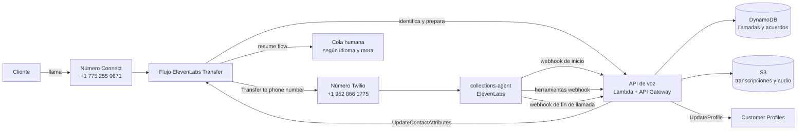
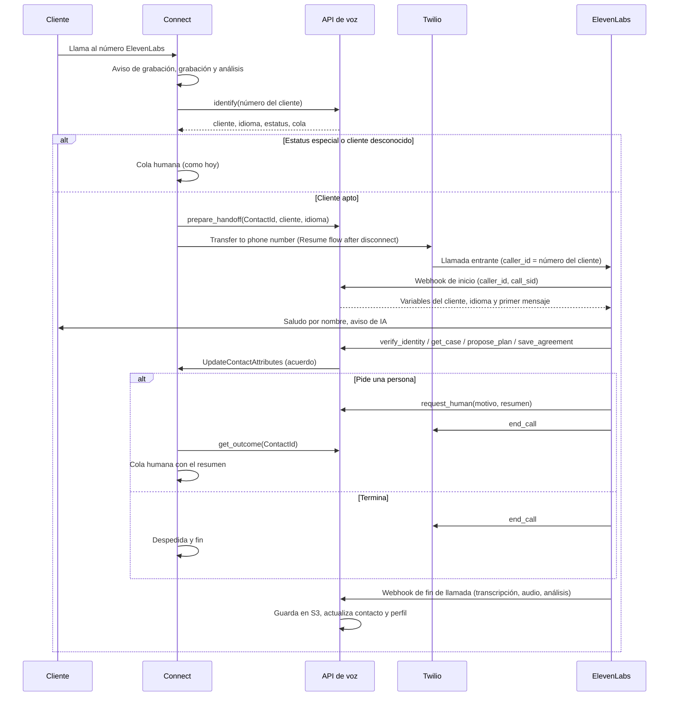

# Diseño: agente de cobranza de ElevenLabs detrás de Amazon Connect (ruta B)

Fecha: 2026-11-12. Estado: **construido (fases 1 a 6) y probado con llamadas reales, entrantes y salientes**; pendiente el envío real del correo (y SMS) de confirmación. Después de la fase 6 (2026-11-12): Sofía anuncia que la confirmación llegará por correo, aunque todavía no se envía; cuando ella termina sin escalar, Connect cuelga sin mensaje propio; la misma ruta sirve para llamadas salientes (Connect marca al cliente y le pasa la llamada a Sofía; el emparejamiento por teléfono funciona porque ElevenLabs recibe el número del cliente); un supervisor las inicia desde la app "Llamar con IA" del espacio de trabajo; y el probador automático (`poc/call-tester`) repite escenarios con un cliente simulado. Ver la sección "Demos de la ruta B" de `poc/README.md`. Cambios respecto del diseño original: la llamada pasa directo al agente (el aviso de grabación lo da Sofía, y a quien no se reconoce le pide el número de cuenta de viva voz, en inglés por defecto); transcripción y audio en `s3://voice-agent-artifacts-383799408374/conversations/<conversation_id>/`. Todo lo marcado como *supuesto* se puede ajustar después; lo marcado como *por verificar* se confirma en las pruebas.

## 1. Objetivo y alcance

Una segunda demo, junto a la del agente de IA con Nova Sonic: la llamada entra por Amazon Connect y la atiende un agente de ElevenLabs con voz natural que negocia un acuerdo de pago con los mismos clientes inventados del demo. El acuerdo, la transcripción y la grabación quedan guardados y se pueden ver desde Connect.

**Por qué esta ruta.** La integración nativa (A2A) está montada y probada del lado de AWS, pero ElevenLabs solo la activa con plan Enterprise, incluso para una PoC ([comparacion-investigaciones-a2a.md](../../docs/research/comparacion-investigaciones-a2a.md)). La ruta B funciona con el plan actual: Connect transfiere la llamada a un número de teléfono atendido por ElevenLabs.

**Fuera de alcance:** llamadas salientes, cobros con tarjeta, envío de SMS o enlaces de pago, datos reales de MEI.

## 2. Decisiones de base

| Decisión | Detalle | Estado |
|---|---|---|
| Entrada | Número de Connect **+1 775 255 0671** (descripción "ElevenLabs"). El flujo A2A queda guardado pero sin número | Decidido |
| Agente | `collections-agent` (`agent_3401m773nf9gekbsv9eqeypdajc5`), un solo agente bilingüe | Decidido |
| Número de ElevenLabs | Twilio **+1 952 866 1775** (`phone1`), hoy asignado a **Lina Colombia**; pasa a `collections-agent` | Decidido (2026-11-12): Lina queda sin número durante la demo |
| Verificación de identidad | Solo confirmar el nombre: "¿Hablo con Maria Hernandez, titular de la cuenta?" Si dice que sí, queda verificada. El cliente ya fue identificado por su número en Connect | Decidido para la demo; en producción se agrega un segundo dato |
| Transferencia | Bloque *Transfer to phone number* con **Resume flow after disconnect** y **sin** identificador personalizado, para que ElevenLabs reciba el número del cliente | Verificado en la documentación de AWS |
| Grabación | La transferencia desde el flujo sigue grabando en Connect | Verificado en documentación (2026-11-09); por verificar en la demo |
| Datos de clientes | `poc/data/customers.csv` como fuente única (tiene fecha de nacimiento y código postal para verificar identidad) | Supuesto |
| Lenguaje del código | Python 3.13 en Lambda y scripts boto3, como el demo actual | Decidido |
| Nombres | Genéricos, sin `mei` ni `demo` | Regla del proyecto |

## 3. Arquitectura



## 4. Flujo de la llamada



Detalles del flujo de Connect (`ElevenLabs Transfer`):

1. *Set logging behavior*, y grabación y análisis (como el demo).
2. Aviso de grabación en el idioma del cliente. El aviso de IA lo dice el agente de ElevenLabs al saludar.
3. Lambda `identify`: busca al cliente por su número, igual que el demo actual. Si no lo reconoce, menú de idioma y código de caso de prueba, también como hoy.
4. Estatus especial (Redemptions, EPD) o cliente desconocido: **no** pasa a la IA, va directo a la cola humana. Es la regla del demo actual.
5. Lambda `prepare_handoff`: guarda en DynamoDB la llamada pendiente (`ContactId`, cliente, idioma, hora), con clave por número del cliente.
6. *Transfer to phone number* al número de Twilio, con **Resume flow after disconnect = Yes** y tiempo de espera de 30 s.
7. Al volver (ElevenLabs colgó y el cliente sigue): Lambda `get_outcome`. Si el resultado es `escalate`, pone el resumen en atributos y transfiere a la cola según idioma y mora. Si no, despedida y fin.
8. Ramas *Call failed*, *Timeout* y *Error* del bloque de transferencia: disculpa y cola humana. El cliente nunca queda colgado por una falla de ElevenLabs.

## 5. Cómo se une el contacto de Connect con la conversación de ElevenLabs

Por una llamada telefónica no viajan los atributos de Connect. La unión se hace en la API:

1. Antes de transferir, `prepare_handoff` guarda `{número del cliente → ContactId, cliente, idioma, expira en 2 min}`.
2. ElevenLabs llama al **webhook de inicio** con `caller_id` (el número del cliente) y `call_sid`. La API busca la llamada pendiente por ese número, la marca como tomada, guarda `call_sid` y devuelve los datos.
3. El **webhook de fin de llamada** trae `conversation_id` y los datos de la llamada telefónica. La API los une con el `ContactId` por `call_sid`.

**Límite conocido:** si el mismo número llama dos veces a la vez, la unión puede equivocarse. Para la demo no importa. En producción se resolvería con SIP y cabeceras, o con la integración nativa.

## 6. Agente de ElevenLabs

**Idioma.** Inglés y español en el mismo agente:
- Idioma principal: español. Inglés como idioma adicional, con su propio primer mensaje (el modelo multilingüe se activa solo).
- El webhook de inicio fija el idioma y el primer mensaje según el perfil del cliente. Hay que habilitar esos campos en la pestaña *Security* del agente.
- Herramienta de sistema **language detection** activa durante toda la llamada. Si hay cambios de idioma falsos en las pruebas, se limita al inicio de la llamada.

**Herramientas de sistema:** `end_call` y `language_detection`. Sin `transfer_to_number`: la persona se consigue colgando y dejando que Connect retome el flujo.

**Herramientas webhook** (todas con una cabecera de secreto compartido guardada en *Workspace Secrets*):

| Herramienta | Entrada | Devuelve |
|---|---|---|
| `confirm_identity` | si el cliente confirmó ser el titular | ok; si dice que no es el titular, el agente no revela datos y termina con cortesía |
| `get_case` | — (usa la llamada en curso) | saldo, fecha de pago, días de mora, monto mínimo |
| `propose_plan` | tipo (pago total, promesa, cuotas), número de cuotas, fecha del primer pago | plan válido con montos y fechas, o el motivo del rechazo |
| `save_agreement` | plan confirmado por el cliente | ID del acuerdo |
| `request_human` | motivo, resumen corto | ok (luego el agente usa `end_call`) |

**Guion (resumen del prompt):** saludo por nombre y aviso de IA y grabación; verificación de identidad **antes** de hablar de montos; explicar el saldo con empatía; ofrecer primero el pago total, luego una promesa de pago, luego cuotas; repetir el acuerdo y pedir confirmación explícita antes de guardarlo; nunca pedir tarjeta ni datos bancarios; si el cliente pide una persona, se enoja, disputa la deuda o menciona abogado o bancarrota, `request_human`. Basado en la estructura de Jess (`~/voice_agent`), reescrito para estos clientes y estas reglas.

**Webhooks del agente:** inicio de conversación y fin de llamada (transcripción, y audio en un evento aparte), configurados en el agente, no en el workspace, para no afectar a Jess ni a Lina.

## 7. API y datos

**API de voz** (API Gateway HTTP + Lambda `voice-agent-api`):

| Ruta | Quién la llama | Qué hace |
|---|---|---|
| `POST /connect/identify` | Flujo (vía Lambda) | Cliente por número; idioma, estatus, cola |
| `POST /connect/prepare-handoff` | Flujo | Guarda la llamada pendiente |
| `POST /connect/outcome` | Flujo | Resultado de la IA para ese `ContactId` |
| `POST /elevenlabs/init` | ElevenLabs | Variables del cliente, idioma, primer mensaje |
| `POST /tools/*` | ElevenLabs | Las cinco herramientas |
| `POST /elevenlabs/post-call` | ElevenLabs | Verifica la firma HMAC; guarda transcripción y audio en S3; actualiza contacto y perfil |

Las tres rutas de Connect pueden ser invocaciones directas de Lambda desde el flujo en vez de rutas HTTP. Se decide al construir.

**DynamoDB:**
- `voice-calls` (clave: `ContactId`): cliente, número, idioma, `call_sid`, `conversation_id`, resultado (`agreement`, `no_agreement`, `escalate`, `failed_verification`), resumen, horas. Índice por número de cliente para la unión del paso 5.
- `payment-agreements` (clave: `agreementId`): cliente, `ContactId`, `conversation_id`, tipo, monto, cuotas y fechas, estado (`active`), origen (`ai` o `human`), creado.

**S3** (`voice-agent-artifacts-<sufijo>`): `transcripts/<ContactId>/<conversation_id>.json` y `audio/<ContactId>/<conversation_id>.mp3`, cifrado por defecto, sin acceso público.

## 8. Reglas de negociación (supuestos, pensadas para explicarse en la demo)

Cada regla cabe en una frase y se puede comprobar en vivo:

1. **Pago total:** siempre se acepta.
2. **Promesa de pago:** la fecha no puede pasar de **7 días**.
3. **Cuotas:** hasta **3 cuotas** cada 2 semanas; la primera dentro de 7 días.
4. **Mora alta:** con **más de 30 días de mora**, el máximo baja a **2 cuotas**.
5. **Sin descuentos.**
6. **Estatus especial** (Redemptions, EPD): siempre a una persona.

El agente nunca promete nada que `propose_plan` no haya validado. Las reglas viven en la API, no en el prompt, para que el modelo no pueda inventar condiciones.

**Dónde se guardan y cómo se cambian (decidido 2026-11-12, para la demo):**
- **Reglas generales:** un JSON de configuración en la API con los valores de arriba (días máximos de promesa, cuotas máximas, cuotas máximas con mora alta, umbral de mora alta, días entre cuotas).
- **Excepciones por cliente:** en el campo estándar **"Información adicional"** (`AdditionalInformation`) del perfil del cliente en Connect, que se puede editar desde el espacio de trabajo del agente con el permiso "Customer profiles – Edit", sin construir nada. Arriba van las notas libres para el agente, en una o varias líneas; debajo de la línea marcadora `[config]` van las reglas en líneas `clave: valor`. Ejemplo:

  ```text
  Prefiere español. Pidió recordatorio por SMS.
  Llamar después de las 5 pm.
  [config]
  maxInstallments: 4
  ```

  Todos los perfiles llevan el marcador y las claves, aunque estén vacías, para que quien edite vea qué se puede cambiar:

  ```text
  Prefiere español.
  [config]
  maxInstallments:
  ```

- **Cómo lo usa la API:** lee el perfil en cada llamada.
  - Todo lo que está **antes** de `[config]` son notas y no se interpreta, aunque tenga `:`.
  - Lo que está **después** se lee como pares `clave: valor`, estén en líneas separadas o en la misma línea (el espacio de trabajo muestra el campo en una sola línea, así que una edición puede dejarlo así: `[config] maxInstallments: 4`). Los valores son números sin espacios; se ignoran los espacios y las mayúsculas en la clave y en el marcador.
  - **Si la clave tiene valor, se usa. Si está vacía, falta, no es un número válido, o el perfil no tiene `[config]`, se usa el valor por defecto** y se anota en el registro.
  - Las claves desconocidas se ignoran, así se pueden agregar más después (por ejemplo, `maxPromiseDays`). Un error al escribir en el perfil nunca rompe la llamada.
- **Momento de la demo:** el supervisor abre el perfil de Maria Hernandez en Connect, cambia `maxInstallments`, se vuelve a llamar y el agente respeta el nuevo límite.
- En producción esto iría en un portal de configuración o en atributos propios del perfil; las líneas en un campo de texto son solo para la demo.

## 9. Qué se ve en Connect

- **Atributos del contacto** (en la búsqueda de contactos y en el detalle): `aiOutcome`, `agreementId`, `agreementSummary` (por ejemplo, "3 cuotas de $393.33 desde 2026-11-19"), `elevenlabsConversationId`, `transcriptKey`.
- **Grabación del contacto**: la de Connect, que debería incluir la conversación con el agente de ElevenLabs (por verificar).
- **Perfil del cliente** en Customer Profiles: último acuerdo en sus atributos, visible para el agente humano.
- **Si pasa a una persona**: el agente ve el resumen de la IA en los atributos del contacto, porque es el mismo contacto.

## 10. Seguridad y cumplimiento

- Herramientas protegidas con un secreto compartido; webhook de fin de llamada verificado con HMAC. Nada de esto es para producción: es para no dejar la API abierta, que es el problema de `~/voice_agent`.
- Solo datos inventados. Los números de teléfono de prueba son del equipo.
- Aviso de grabación (Connect) y de IA (agente) al inicio.
- Sin datos de tarjeta en ningún punto.
- Revisión legal pendiente del guion de cobranza (TCPA, grabación, prácticas de cobro), como en el resto del proyecto.

## 11. Recursos nuevos

| Recurso | Nombre |
|---|---|
| Flujo de Connect | `ElevenLabs Transfer` |
| Lambda | `voice-agent-api` (y, si hace falta, una Lambda ligera para el flujo) |
| API Gateway | `voice-agent-api` |
| DynamoDB | `voice-calls`, `payment-agreements` |
| S3 | `voice-agent-artifacts-<sufijo>` |
| Scripts | `poc/infra/elevenlabs-route-b/` (Python + boto3, re-ejecutables) |
| Prompt y herramientas del agente | `poc/elevenlabs-ruta-b/agent/` (versionados en el repo, aplicados por API) |

## 12. Plan de construcción

1. **Datos y reglas:** carga de clientes desde `customers.csv`, reglas de negociación con pruebas unitarias.
2. **API y almacenamiento:** Lambda, API Gateway, DynamoDB y S3; probar las herramientas con `curl`.
3. **Agente de ElevenLabs:** prompt, idiomas, herramientas, webhooks y overrides por API; probar en la consola de ElevenLabs y con simulaciones.
4. **Número de Twilio:** asignarlo a `collections-agent`; llamada directa de prueba.
5. **Flujo de Connect:** `identify` → `prepare_handoff` → transferencia → `get_outcome`; asignarlo al número.
6. **Fin de llamada:** S3, atributos del contacto y perfil.
7. **Pruebas de punta a punta** (sección 13) y guion de la demo.

## 13. Pruebas

| Caso | Cliente | Qué se espera |
|---|---|---|
| Pago total, inglés | Michael Johnson (al día) | Acuerdo de pago total, atributos en el contacto |
| Cuotas, español | Maria Hernandez (5 días) | Plan de 2 a 4 cuotas, transcripción en S3 |
| Mora alta | Luisa Ramirez (47 días) | Máximo 2 cuotas |
| Excepción por cliente en vivo | Maria Hernandez, antes y después de editar su perfil en Connect (`maxInstallments`: 4) | El agente ofrece hasta 3 cuotas y luego hasta 4 |
| Valor inválido en el perfil | `maxInstallments: cuatro` | El agente usa el valor por defecto; la llamada sigue normal |
| Cambio de idioma | Cliente en español que pasa a inglés | El agente cambia y sigue la negociación |
| Pide una persona | Cualquiera | ElevenLabs cuelga, Connect retoma y pasa a la cola con el resumen |
| Estatus especial | David Thompson (Redemptions) | No pasa a la IA, va directo a la cola |
| Falla de ElevenLabs | Número de Twilio sin agente | Disculpa y cola humana |
| No es el titular | Quien contesta dice que no es la persona | El agente no revela montos y termina con cortesía |

Las llamadas con conversación las hace una persona (por ejemplo, con `demo.caller2` o un teléfono propio). Las llamadas de Twilio con texto fijo sirven solo para probar el camino técnico.

## 14. Riesgos y puntos por verificar

- **Unión por número del cliente** (sección 5): por verificar que ElevenLabs reciba en `caller_id` el número original que pasa Connect.
- **Grabación del tramo de ElevenLabs** en Connect, y si Contact Lens lo analiza.
- **Latencia y calidad** con dos tramos telefónicos (Connect a Twilio): por medir.
- **Límites del plan Starter** de ElevenLabs: minutos y concurrencia. Alcanza para la demo.
- **Costo:** Connect cobra el tramo de entrada y el de salida a Twilio, más Twilio y ElevenLabs por minuto. Son centavos por llamada de prueba.
- **Lina Colombia pierde su número** mientras dure la demo.

## 15. Decisiones

Tomadas el 2026-11-12:
1. Lina Colombia se queda sin el número de Twilio durante la demo.
2. Verificación solo confirmando el nombre del titular; el segundo dato queda para producción.
3. Reglas simples de la sección 8, explicables en la demo.

4. Excepciones de reglas por cliente en el campo "Información adicional" del perfil, debajo de la línea `[config]`, con notas libres arriba; editable desde Connect (sección 8).

5. Comprobado el 2026-11-12 en el espacio de trabajo: los atributos personalizados se **ven** en "More information" pero **no se editan** en "Update profile"; "Additional info" sí se edita (hasta 1000 caracteres) y conserva los saltos de línea. Por eso las reglas van en "Additional info" con `[config]`.
6. Editan perfiles solo `demo.admin` (perfil Admin) y `demo.supervisor` y `demo.agent2` (perfil de seguridad adicional "Profile Editor": ver y editar perfiles). Los demás usuarios solo ven.
7. Los teléfonos inventados de los clientes usan el rango ficticio 555-01xx (por ejemplo, +1 210 555 0102), porque el espacio de trabajo rechaza `+1000000000x` al guardar.
